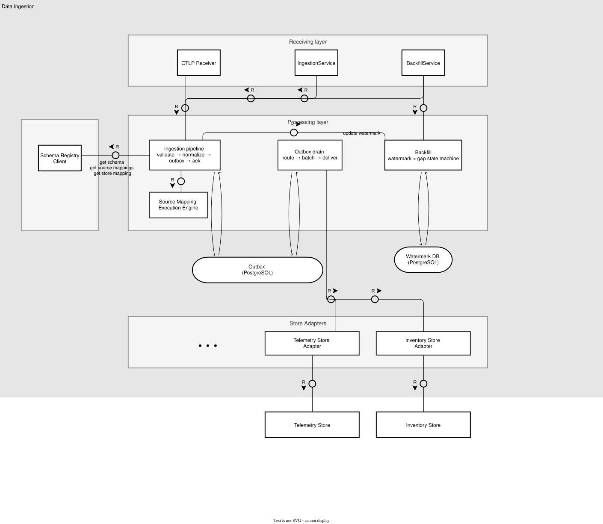
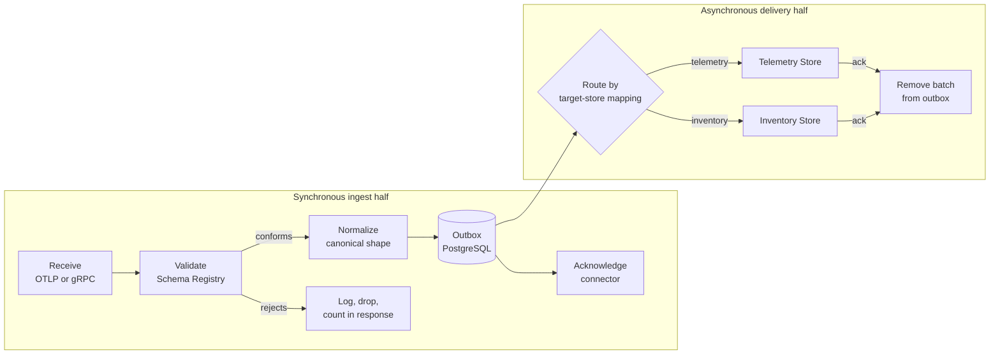
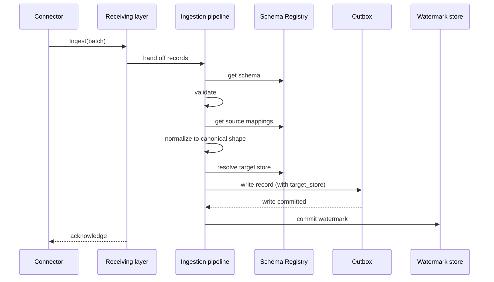
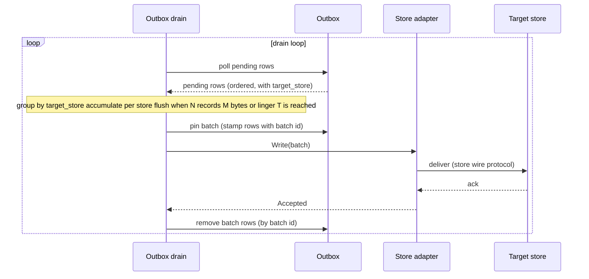

# Data Ingestion Implementation

## Overview

Data Ingestion is the single write path into the Operational Context Graph (OCG). It receives records from connectors, validates each against the registered schema in the Schema Registry, normalizes each into its canonical shape, and routes each to the store that owns it.

## Component structure

This diagram shows the different components inside of the Data Ingestion.



- **Clients** talk to external systems and are used by the processing layer.
  - The **Schema Registry Client** is the REST API client for the Schema Registry web service. It hides the HTTP calls and fetches artifacts - the schema, the source mapping, and the target-store mapping for a `(logical_artifact_type, schema_version)`, plus the default telemetry schema. It caches the immutable results in memory.
- **Store adapters** deliver the data to the stores. They are more than just a client because they can contain logic that is specific to the store they belong to (beyond just mapping it to the wire format).
  - The **Telemetry Store adapter** and **Inventory Store adapter** each implement the shared store-writer interface and map a batch of records (which adhere to the canonical data model) to their store's own wire protocol.
- **Processing layer:** Contains the **ingestion pipeline** (validate → normalize → write outbox → ack), the **Source Mapping Execution Engine** (applies a source-mapping artifact to produce the canonical record), the **outbox drain** (route to the target store, batch, deliver at-least-once), and the **backfill** logic (watermark store and gap state machine).
- **Receiving layer** defines the wire protocols for the connectors and calls the processing layer.

### Go interfaces between the layers

The signatures below are **illustrative, not final**. They fix the shape of each boundary so the client, processing-layer, and receiving-layer tickets can start in parallel. The dependent ticket owners can deviate from these proposals.

```go
// Processing layer.

// SchemaKey identifies one immutable schema release: the (logical_artifact_type, schema_version) pair.
// Passing it as one value (instead of two adjacent strings) keeps call sites type-safe and
// prevents swapping the two arguments by mistake.
type SchemaKey struct {
    Type    string
    Version string
}

// IngestRecord is the wire-neutral input the ingestion pipeline consumes. Each receiver maps its own
// wire format into it: the gRPC services copy it from MessageEnvelope (near field-for-field),
// and the OTLP receiver builds it from each OTLP record plus the logical_artifact_type/schema_version
// metadata headers.
type IngestRecord struct {
    Schema      SchemaKey
    Payload     []byte
    ContentType string
    Partition   []byte // optional, opaque; empty for OTLP (push-only, no backfill)
    Watermark   []byte // optional, opaque; empty for OTLP
}

// Ingestor is the ingestion pipeline entry point. The receiving layer (IngestionService,
// BackfillService.Ingest, and the OTLP receiver) maps its wire format into a batch of
// IngestRecord and calls Ingest, which runs the synchronous ingest half: validate, normalize,
// and write each record to the outbox.
type Ingestor interface {
    // Ingest processes one batch and returns per-batch counts. Record-level problems (failed
    // schema, unregistered type) are counted in IngestResult, not returned as errors, so one
    // bad record does not stop the others. A non-nil error is a request-level failure (for
    // example the outbox is unavailable); the receiving layer maps it to a gRPC status and
    // back-pressures the connector.
    Ingest(ctx context.Context, batch []IngestRecord) (IngestResult, error)
}

// IngestResult reports per-batch counts; Accepted + Rejected == len(batch). The receiving layer maps
// Rejected to IngestResponse.partial_success.rejected_messages, which is an int64 count (plus one
// optional aggregate error_message); the proto carries no per-envelope detail.
type IngestResult struct {
    Accepted int
    Rejected int
}

// Source Mapping Execution Engine (processing layer). Applies a source-mapping artifact
// (fetched from the Schema Registry) to a validated record and returns the canonical record.
type SourceMappingExecutionEngine interface {
    Normalize(mapping SourceMapping, record IngestRecord) (CanonicalRecord, error)
}

// Clients layer.

// Schema Registry Client (#274). Immutable per ADR-012, so results are cached. The lookups take
// a context because they may reach the registry on a cache miss.
type SchemaRegistryClient interface {
    Schema(ctx context.Context, key SchemaKey) (Schema, error)
    SourceMappings(ctx context.Context, sourceKey SchemaKey) (SourceMapping, error)
    TargetStore(ctx context.Context, key SchemaKey) (StoreID, error)
    DefaultLogSchema(ctx context.Context) (SchemaKey, error)
    DefaultTraceSchema(ctx context.Context) (SchemaKey, error)
    DefaultMetricSchema(ctx context.Context) (SchemaKey, error)

}

// ErrOverloaded reports transient store back-pressure: the batch was not written and the drain
// should pause this store and retry the same batch later. A PermanentError reports a batch the
// store will never accept; the drain logs it and moves on. Any other non-nil error is an
// unexpected failure the drain treats like back-pressure (pause and retry).
var ErrOverloaded = errors.New("store overloaded")

type PermanentError struct {
    Reason string
}

func (e *PermanentError) Error() string { return e.Reason }

// Shared store-writer interface implemented by each adapter (#275, #276).
type StoreWriter interface {
    // StoreID is the destination this adapter serves. It must match the outbox target_store
    // value and the Schema Registry's target-store mapping.
    StoreID() StoreID
    // Write delivers one immutable batch. A nil error means the store accepted the batch.
    // Callers distinguish failures with errors.Is(err, ErrOverloaded) and errors.As for
    // *PermanentError.
    Write(ctx context.Context, batch []CanonicalRecord) error
    // Limits reports this store's batch thresholds: max records N, max bytes M, max linger T.
    Limits() BatchLimits
}
```

The two adapters depend only on `StoreWriter`, so the drain stays generic.

## Receiving layer

The interfaces are defined in the [OCG Data Ingestion Protocol](./ingestion-protocol.md).

### OTLP telemetry interface

Standard OpenTelemetry Protocol for telemetry. `logical_artifact_type` and `schema_version` are passed as gRPC metadata headers; when unset, Data Ingestion uses the telemetry defaults from the Schema Registry. This lets OTel-native systems connect without a custom connector. OTLP requests are handed to the same ingestion logic as the gRPC protocol.

### OCG Data Ingestion gRPC protocol

For sources that do not support OTLP natively (inventory, polled telemetry). Two services:

- **`IngestionService.Ingest`** - unary batch push of `MessageEnvelope` messages. Mirrors OTLP but uses the general message type. Returns `IngestResponse` with a rejected-message count.
- **`BackfillService`** - `Ingest`, `GetWatermark`, `StartGap`, `CloseGap`. Adds watermark tracking via per-`(connector, partition)` watermark. Use it when record loss is not acceptable.

Both wire formats stop at the receiving layer. Each receiver maps its format into one wire-neutral record type that the ingestion pipeline consumes (see Go code above `IngestRecord`), so the processing layer depends on no wire-specific type. The gRPC services copy it from `MessageEnvelope` field for field. The OTLP receiver builds one record per OTLP record, taking `logical_artifact_type` and `schema_version` from the metadata headers; `partition` and `watermark` stay empty because OTLP is push-only with no backfill.

## Processing layer

We use an outbox to deal with back pressure from the stores. This splits the pipeline into two halves. The **synchronous ingest half** runs in the connector's request and ends when the record is durable in the outbox; the connector is then acknowledged. The **asynchronous delivery half** drains the outbox to the stores at each store's own pace. A record is removed from the outbox only after its target store acknowledges it (at-least-once semantic for sending data to the stores).



The target store for each `(logical_artifact_type, schema_version)` is defined in the Schema Registry. Data Ingestion holds no routing rules of its own. The ingest half resolves the target store from the Schema Registry Client during normalization and persists it on the outbox row (`target_store`). The drain then uses that column to route the data to the appropriate store. Resolving once at ingest costs no extra round trip, because the ingest half already calls the registry for the schema and source mappings, and the mapping is stable because schemas are immutable (ADR-012).

### Outbox schema

The outbox reuses the existing OCG PostgreSQL instance. All records share one outbox table. This harmonizes the generic components and allows us to add more stores in the future easily. A `target_store` column discriminates the destination. If delivery volume ever demands it, the one table can be partitioned by `target_store` without changing this logical model.

Schema proposal:

| Column                                    | Purpose                                                                                                |
| ----------------------------------------- | ------------------------------------------------------------------------------------------------------ |
| `id`                                      | Monotonic sequence, primary key. Defines outbox order. Set on DB level, not in application code.       |
| `target_store`                            | `StoreID` of the destination, resolved from the registry at ingest. The drain groups and routes by it. |
| `logical_artifact_type`, `schema_version` | Specify the schema of the canonical data model.                                                        |
| `payload`                                 | The canonical record written by the ingestion pipeline after normalization.                            |
| `content_type`                            | Optional, carried from the envelope.                                                                   |
| `batch_id`                                | Nullable. `NULL` means pending; the drain sets it when it pins the batch.                              |
| `created_at`                              | Insert time, used for linger and observability.                                                        |

Two indexes support the drain: a partial index on `(target_store, id) WHERE batch_id IS NULL` for "pending rows for a store, in order," and an index on `batch_id` for resend and delete. The drain keeps no per-row delivery bookkeeping (no attempt count or last-error column); a failed write is retried on the pinned batch, and a permanent failure is logged (see the store-writer interface below).

### Ingest half

The synchronous ingest half enforces two ordering rules: the record is made durable in the outbox first, and both the watermark commit (for backfill) and the connector acknowledgement happen only after that write succeeds.



#### Rejections

**Rejection.** As defined in the [Data Ingestion Protocol](./ingestion-protocol.md), record-level problems (missing `logical_artifact_type`, payload that fails its schema) are not request failures. The record is not written, and the rejected count is returned in `IngestResponse.partial_success` (`rejected_messages`). One bad record does not stop the others.

A record that cannot be processed (e.g. it does not match the specified schema; or the schema is unknown) is logged and dropped. In both cases Data Ingestion writes a log entry, drops the record, and counts it in the response.

#### Normalization

Each validated record is mapped to the canonical schema. The Schema Registry Client fetches the source-mapping artifact for the record's `(logical_artifact_type, schema_version)` from the Schema Registry, and the Source Mapping Execution Engine applies that artifact to produce the canonical record. The client only fetches the artifact; the engine only transforms. This separation keeps the Data Ingestion implementation generic.

The Source Mapping Execution Engine is a component that is part of the ingestion pipeline. Its logic is described in its own section.

### Delivery half

The asynchronous delivery half enforces the third ordering rule: a batch's rows leave the outbox only after the target store acknowledges the batch.

The drain runs a continuous loop. On each pass it reads the pending rows from the outbox and groups them by `target_store`. It then accumulates rows into each store's open batch and flushes that batch when the store's record count `N`, byte size `M`, or linger time `T` is reached - whichever comes first. The linger timer `T` bounds latency when traffic is low, so a partly filled batch does not wait indefinitely. Every row is pinned to a batch before the store is called, so a crash or restart does not lose the membership of a linger-triggered batch. The drain calls the store adapter to write the batch, and on success it removes those rows from the outbox.



#### Store-writer interface

The drain treats every store the same way through one shared **store-writer interface**. It takes a batch of normalized records and signals one of three outcomes (expressed as a Go `error`, see the Component structure and layering section):

- **Accepted** - the store durably took the batch; the drain removes those rows from the outbox.
  The adapter returns a `nil` error.
- **Overloaded** - the store is temporarily unable to accept more; the drain pauses that store and
  retries the pinned batch with exponential back-off and jitter, capped at a maximum interval.
  Other stores keep draining. The adapter returns `ErrOverloaded`.
- **PermanentFailure** - the batch can never succeed as written (for example a store-side rejection).
  The drain logs the error and drops the batch's rows from the outbox. This is a permanent loss of data that will not reach the store. New records for that store are still accepted. The adapter returns a `PermanentError`.

Each adapter reports its batch limits to the drain: maximum records (N), maximum bytes (M), and maximum linger time (T).

Each adapter also declares the `StoreID` it serves, so the drain can map a row's `target_store` to the adapter that handles it. The same `StoreID` vocabulary must be used by the Schema Registry's target-store mapping, the outbox `target_store` column, and the adapter's declared identity.

#### Batching

The drain polls the outbox on a bounded interval. On each pass it reads the pending rows for a store, in outbox order, and forms a batch using that store's `(N, M, T)` limits: it closes the batch when the record count `N`, byte size `M`, or linger time `T` is reached, whichever comes first.

When the batch closes, the drain **pins its membership** in the outbox: it stamps the exact rows of the batch with a batch identifier before it calls the store. A batch is **immutable once pinned**. Pinning the membership is what makes the batch survive the time trigger and a restart: the `N` and `M` triggers are a pure function of the pending rows, but a `T`-triggered batch holds "whatever had arrived when the timer fired," which the pending set alone cannot reproduce after new rows arrive. On restart the drain resends the pinned rows exactly, with none added and none removed, so delivery replays the identical batch in the same order.

The batch identifier yields a deterministic idempotency key per batch. The ack and the row deletion do not need to be atomic: if the drain crashes after the store acknowledges the batch but before it removes the rows, the pinned batch is resent on restart with the same key, the store deduplicates it (see per-store idempotency below), and then the rows are removed.

ADR-013 also describes an alternative where each adapter owns its batching, needed only for adaptive batching under store pressure; both sit behind the same store-writer interface, so the choice can change later without touching the outbox or the ingestion pipeline. This design uses the fixed `(N, M, T)` loop with bounded polling.

#### Concurrency

The initial implementation runs a single drain process with one worker per `target_store`. Each worker owns its store's batching, back-off, and pending-row scan, so an overloaded store pauses only its own worker and the other stores keep draining. This gives per-store isolation without any distributed coordination. Scaling to several drain instances is a later step and uses the approaches in the Scalability section (shard by store, or claim rows with `SELECT ... FOR UPDATE SKIP LOCKED`).

## Store adapters

A store adapter declares the `StoreID` it serves, implements the store-writer interface, and sends the data to the store. Each adapter is responsible for any logic that is specific to the store it belongs to. For example, if multiple requests must be sent to the store to deliver a batch, the adapter handles that. The drain does not know about the store's wire protocol or any store-specific logic; it only calls the adapter's `Write` method with a batch of normalized records.

### Per-store idempotency

- **Telemetry Store:** if the ingest API accepts an idempotency key (for example a load label), the adapter derives it deterministically from the batch, so a retry reuses the same key.
- **Inventory Store:** the write is an upsert on the record's natural key, so a retry overwrites rather than duplicates.

## Scalability

The service scales horizontally, but the two pipeline halves scale differently. The stateless compute scales out easily. The shared PostgreSQL outbox is the real throughput ceiling. The table below summarizes each part; the sections after it give the details.

| Part                   | Horizontal scaling                                                            |
| ---------------------- | ----------------------------------------------------------------------------- |
| Ingest replicas        | Easy, given per-partition watermark affinity                                  |
| Schema Registry Client | Easy - per-replica cache over immutable data (ADR-012)                        |
| Outbox drain           | Needs sharding or row-level locking; at-least-once keeps it correct meanwhile |
| PostgreSQL outbox      | The real ceiling - needs table partitioning, then database sharding           |

No part is a hard blocker. Correctness holds even under contention, because at-least-once delivery plus the per-store idempotency key makes a duplicate delivery safe. The limits are throughput and ordering, not correctness.

### Ingest half scales with replicas

Each ingest request is almost stateless: receive, validate, normalize, write the outbox row, and acknowledge the connector. The Schema Registry Client caches immutable schemas per replica, so replicas share no cache. You can run many ingest replicas behind a load balancer, and each one adds throughput.

One constraint applies. A watermark must advance in order per partition (#279). If two replicas process the same partition's stream at the same time, their watermark updates race. Route each partition's stream to one replica at a time, through sticky routing or a per-partition lock. OTLP has no partition or watermark, so push-only telemetry is not affected.

### The drain needs coordination to scale

The drain polls the outbox, pins a batch with `batch_id`, writes it through the store adapter, and deletes the rows after the store acknowledges them. Running several drain instances without coordination makes them compete for the same rows. The result is duplicate deliveries and possible reordering within a target store.

To scale the drain safely, choose one of these approaches:

- **Shard the work** by `target_store` (and optionally a partition key) and give each shard one
  owner. Ordering holds within a shard.
- **Claim rows with `SELECT ... FOR UPDATE SKIP LOCKED`**, so concurrent drains pull disjoint row
  sets.
- **Run one active drain per store** through leader election. This is the simplest option, but it
  caps a store's throughput at one worker.

The first implementation runs a single drain process with one worker per store (see the Persistent outbox and delivery section). These approaches apply when that single instance saturates and you move to several drain instances.

### The outbox database is the throughput ceiling

Both halves funnel through one PostgreSQL instance. Every ingest insert and every drain delete hits that database. At the Telemetry Store's target rate of at least 100,000 events per second (ADR-011), the outbox write path reaches its limit before the compute does.

Two mitigations extend the ceiling:

- **Partition the outbox table** by `target_store` or by hash, so writes and the drain's scans
  spread across partitions.
- **Shard the outbox across several PostgreSQL instances.** This removes the single-database cap,
  but it complicates cross-store operations and backfill. Treat it as a later step.
