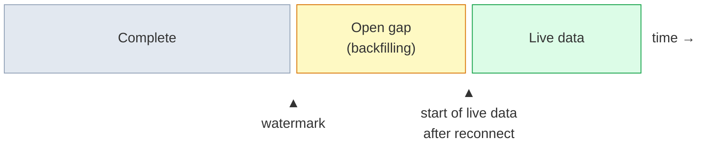
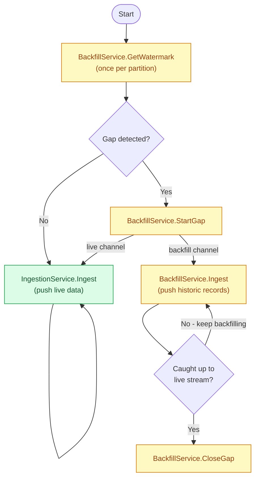

# Ingestion protocol

Data Ingestion is the single write entry point into the Operational Context Graph (OCG). Every connector submits records through this service, regardless of data type or rate. Before a record is written to any store, Data Ingestion validates it against a schema from the Schema Registry. Records that fail validation are rejected and do not reach the store.

Two interfaces are available:

- **OTLP telemetry interface** - for telemetry data. Telemetry data uses the standard OpenTelemetry Protocol; the schema type and version are passed as gRPC metadata headers.
- **(OCG) Data Ingestion Interface** - for all types of data. The interface is implemented as two gRPC services. A request can contain multiple messages. Each message references a schema type and version that describe the message payload, so a single request can contain records of different types.

There is already a rich ecosystem of OpenTelemetry-native systems that push telemetry to OTLP receivers. The OTLP interface lets these systems connect to Data Ingestion using their existing libraries and SDKs without writing a custom connector. Telemetry can arrive directly from the data source or pass through one or more OTLP collectors for filtering or batching.

The OCG Data Ingestion gRPC services (i.e. `IngestionService` and `BackfillService`) should be used for data sources that do not support OTLP natively. This includes data that does not fit the Logs/Traces/Metrics model - such as inventory data - and telemetry data that a connector polls from the source rather than receives as a push.
The gRPC protocol supports mutual TLS (mTLS) for authentication.

## gRPC metadata headers

Both interfaces, native OTLP and OCG Data Ingestion, use [gRPC metadata](https://grpc.io/docs/guides/metadata/) for request-level headers.

| Header                  | Applies to | Required    | Description                                                                                                                                |
| ----------------------- | ---------- | ----------- | ------------------------------------------------------------------------------------------------------------------------------------------ |
| `correlation-id`        | Both       | SHOULD      | An opaque value the connector generates per request. Data Ingestion propagates it in logs and traces to enable end-to-end request tracing. |
| `connector-id`          | Both       | Conditional | Connector identity. Required when mTLS is not used. See [Connector identity](#connector-identity).                                         |
| `logical_artifact_type` | OTLP only  | Optional    | Logical artifact type for the OTLP payload. If not set, Data Ingestion uses the default schema type for telemetry data.                    |
| `schema_version`        | OTLP only  | Optional    | Schema version for the OTLP payload. If not set, Data Ingestion uses the default schema version for telemetry data.                        |

## OTLP telemetry interface

Data Ingestion accepts standard OTLP requests from telemetry connectors (see the [OTLP specification](https://opentelemetry.io/docs/specs/otlp/)).

Beyond the official OTLP spec, connectors can set additional gRPC metadata headers. See [gRPC metadata headers](#grpc-metadata-headers).

If OTLP data must not be lost, the connector must implement its own retry and catch-up logic.

## Data Ingestion gRPC services

`IngestionService` and `BackfillService` both follow the same request/response pattern as OTLP, but define their own messages. The connector establishes a gRPC connection to Data Ingestion and pushes records in batches via unary gRPC requests. The response indicates how many records were rejected.

**gRPC Service definition:**

```proto
message MessageEnvelope {
  string logical_artifact_type = 1; // required
  string schema_version = 2; // required
  // Serialized JSON payload
  bytes payload = 3; // required
  // Opaque partition key supplied by the connector. The server never interprets
  // the contents; it is used only as part of the storage key for watermark tracking.
  google.protobuf.Struct partition = 4; // optional
  // Opaque watermark within partition at which this message was read.
  // The server stores this value and returns it via GetWatermark so the connector
  // can resume from the correct position on restart.
  google.protobuf.Struct watermark = 5; // optional
  // MIME type of the payload (e.g. "application/json"). Defaults to "application/json" if not set.
  optional string content_type = 6; // optional
}

message IngestRequest {
  repeated MessageEnvelope messages = 1; // required
}

message IngestPartialSuccess {
  int64 rejected_messages = 1; // required
  optional string error_message = 2;
}

message IngestResponse {
  IngestPartialSuccess partial_success = 1; // required
}

// GetWatermarkRequest - connector identity comes from mTLS cert CN or connector-id header.
message GetWatermarkRequest {
  google.protobuf.Struct partition = 1; // optional
}

message GetWatermarkResponse {
  // Echo of the requested partition (allows multiplexed concurrent calls).
  google.protobuf.Struct partition = 1;
  // Last committed watermark for this (connector, partition) pair.
  google.protobuf.Struct watermark = 2; // required
}

// IngestionService - unary-push ingestion for generic (non-OTLP) envelopes.
service IngestionService {
  rpc Ingest(IngestRequest) returns (IngestResponse);
}

// BACKFILL

message StartGapRequest {
  // Opaque partition key. Identifies which partition has the gap.
  google.protobuf.Struct partition = 1; // required
}

message StartGapResponse {}

message CloseGapRequest {
  // Opaque partition key. Identifies which partition has the gap.
  google.protobuf.Struct partition = 1; // required
}

message CloseGapResponse {}

service BackfillService {
  rpc Ingest(IngestRequest) returns (IngestResponse);
  rpc GetWatermark(GetWatermarkRequest) returns (GetWatermarkResponse);
  rpc StartGap(StartGapRequest) returns (StartGapResponse);
  rpc CloseGap(CloseGapRequest) returns (CloseGapResponse);
}
```

The separation into two services allows the connector to choose a communication pattern suitable for different use cases. In its simplest form, the connector pushes messages to the Data Ingestion via `IngestionService.Ingest`. This is mirroring the behavior of the OTLP protocol, but uses our more general message definition. While it might be acceptable to lose some individual types of data (e.g. logs or traces) this might not be acceptable for other types of data (e.g. inventory data). The `BackfillService` adds functionality that SHOULD be used by the connector, if at-least-once semantic is required.

### IngestionService

`IngestionService` has one RPC: `Ingest`. The connector uses it to push live data in batches.

**gRPC methods:**

**`Ingest`**: Pushes a batch of messages to Data Ingestion.

### BackfillService

The `BackfillService` provides functionality for the connector to look up to which point (a.k.a. watermark) the data was ingested without any gaps. If it identifies a gap between the watermark and the latest data in the source, it can register the gap and start backfilling the missing data.



**gRPC methods:**

**`GetWatermark`**: Returns the last committed watermark for a `(connector, partition)` pair. Call this on startup, once per source partition the connector manages. If `watermark` in the response is empty, no watermark has been recorded yet. Treat an empty watermark as a gap and start backfilling from the beginning of the source.

**`StartGap`**: Tells Data Ingestion that a gap exists for a partition. Call this before starting a parallel backfill. After this call, Data Ingestion stops advancing the watermark from the live stream for that `(connector, partition)` pair.

**`CloseGap`**: Tells Data Ingestion that the gap for a partition has been closed. Call this after the backfill has caught up to the live stream. It is the responsibility of the connector to identify when a gap was closed. After this call, Data Ingestion resumes advancing the watermark from the live stream for that `(connector, partition)` pair.

**`Ingest`**: Pushes a batch of messages to Data Ingestion. If there is no gap for the `(connector, partition)` pair, the messages are ignored by the Data Ingestion.

### Message format

Each payload is wrapped in a `MessageEnvelope`. The connector can decide how many messages to batch into a single request. The request can contain messages belonging to different logical artifacts and source partitions. The attributes `logical_artifact_type`, `schema_version`, and `payload` describe the data being ingested. The attributes `partition` and `watermark` are used to track the connector's position in the source. The partition allows the connector to parallelize ingestion of one source across multiple pods. The watermark is tracked per partition and connector. It is the connector's responsibility to ensure that only one pod is ingesting from a given partition at any time. The connector chooses the partitioning scheme and watermark structure. Data Ingestion treats both fields as opaque.

| Field                   | Type   | Required | Description                                                                                                                                                                                                                                                                                                                                                                                                                                                                  |
| ----------------------- | ------ | -------- | ---------------------------------------------------------------------------------------------------------------------------------------------------------------------------------------------------------------------------------------------------------------------------------------------------------------------------------------------------------------------------------------------------------------------------------------------------------------------------- |
| `logical_artifact_type` | string | Yes      | The logical artifact that identifies the schema (e.g. `ocg.inventory.server`) which is stored in the Schema Registry.                                                                                                                                                                                                                                                                                                                                                        |
| `schema_version`        | string | Yes      | The schema version to validate the payload against. The pair of `logical_artifact_type` and `schema_version` uniquely identifies the schema.                                                                                                                                                                                                                                                                                                                                 |
| `payload`               | bytes  | Yes      | The record bytes to validate and store. The payload MUST be in the form of a serialized JSON.                                                                                                                                                                                                                                                                                                                                                                                |
| `partition`             | Struct | No       | Opaque map identifying which part of the source this message came from (e.g. `{"table": "servers"}`). Used as part of the watermark tracking key. Connectors that do not need to resume after a restart can leave this field unset.                                                                                                                                                                                                                                          |
| `watermark`             | Struct | No       | Opaque map indicating the position within `partition` at which this message was read (e.g. `{"last_id": 4821}`). Data Ingestion stores this and returns it via `BackfillService.GetWatermark` so the connector can resume from the correct position on restart. Depending on the source type, this might be an `updated_at` timestamp, a Log Sequence Number (LSN), or a pagination token. Connectors that do not need to resume after a restart can leave this field unset. |
| `content_type`          | string | No       | MIME type of the payload (e.g. `application/json`). Defaults to `application/json` if not set.                                                                                                                                                                                                                                                                                                                                                                               |

**Watermark handling:**

- If `partition` and `watermark` are set, Data Ingestion updates the last committed watermark for that `(connector, partition)` pair.
- If `partition` is not set but `watermark` is set, Data Ingestion tracks the watermark per connector with no partition key.
- If `watermark` is not set, Data Ingestion does not update the last committed watermark for that `(connector, partition)` pair.

Note: see [Watermark advancement](#watermark-advancement) to understand the implications of a gap on watermark handling.

If the request contains multiple messages for the same partition, Data Ingestion updates the last committed watermark to the _last_ watermark set in the list of messages (the ordering of the message envelopes matters). If the request contains messages for different partitions, Data Ingestion updates the last committed watermark for each partition independently.

### Connector startup sequence

Every connector that supports backfilling runs this sequence on startup/reconnect, before it begins pushing live data.



### Watermark advancement

A connector can have two channels open to Data Ingestion: a live channel for current events and a backfill channel for historic events. The watermark semantics depend on whether a gap exists between the last committed watermark and the latest data in the source.

- **No gap**: Data Ingestion advances the watermark from the live stream (`IngestionService.Ingest`).
- **Gap exists**: Data Ingestion does not advance the watermark from the live stream. The watermark advances only from the backfill channel (`BackfillService.Ingest`).
- **Gap closes**: the watermark jumps to the last event processed by the live stream.

### Error handling

The following rules apply to both `IngestionService.Ingest` and `BackfillService.Ingest`.

Error handling operates at two levels: request-level and record-level.

#### Request-level errors

Request-level errors are returned as gRPC status codes. They indicate that the entire request failed and no records were written.

| Status code          | Meaning                                                                                                                                                                                                   | Retryable                                            |
| -------------------- | --------------------------------------------------------------------------------------------------------------------------------------------------------------------------------------------------------- | ---------------------------------------------------- |
| `INVALID_ARGUMENT`   | The request is malformed at the protocol level - for example, `messages` is empty.                                                                                                                        | No                                                   |
| `RESOURCE_EXHAUSTED` | For example, if the request exceeds the defined size limits, or runs into a rate limit.                                                                                                                   | Yes, if a `RetryInfo` was set in the response error. |
| `UNAVAILABLE`        | Data Ingestion is overloaded. The response includes a `google.rpc.RetryInfo` extension with the recommended retry delay. The connector must back off for at least the indicated duration before retrying. | Yes - after `RetryInfo` delay                        |
| `INTERNAL`           | An unexpected server error occurred.                                                                                                                                                                      | No                                                   |

If mTLS is used, `UNAUTHENTICATED` and `PERMISSION_DENIED` are returned by the gRPC transport layer when mTLS authentication fails. They are not part of the application protocol.

#### Record-level rejections

Per-envelope issues (e.g. a missing `logical_artifact_type` or a schema that is not registered) are not request-level failures. They are treated as record-level rejections. The Data Ingestion reports the number of rejected records in the `IngestResponse` (`partial_success.rejected_messages`). Rejected records are not written to the store. A rejected record does not stop the ingestion of other records.

### Back pressure and throttling

When Data Ingestion returns `UNAVAILABLE`, the connector must stop sending immediately. If a `RetryInfo` is specified in the response, it must wait for the duration specified before retrying. Continuing to send after receiving `UNAVAILABLE` is a protocol violation.

### Size limits

| Limit                        | Value |
| ---------------------------- | ----- |
| Maximum request payload      | 4 MiB |
| Maximum messages per request | 1 000 |

If a request exceeds any of these limits, Data Ingestion returns `RESOURCE_EXHAUSTED` and no records are written.

### Connector identity

Data Ingestion identifies the connector across both interfaces (e.g. for watermark tracking). The connector identity is taken from the mTLS certificate CN if mTLS is used, or from the `connector-id` gRPC metadata header if no mTLS is used. The connector identity must be unique across all connectors (i.e. two different connector implementations must have a different connector identity, but all pods of the same connector share the same connector identity).

### Compression

Both interfaces support gzip compression. A connector can send its requests to Data Ingestion
uncompressed or gzip-compressed on the OTLP telemetry interface and on the OCG Data Ingestion
gRPC services. Data Ingestion accepts both.
