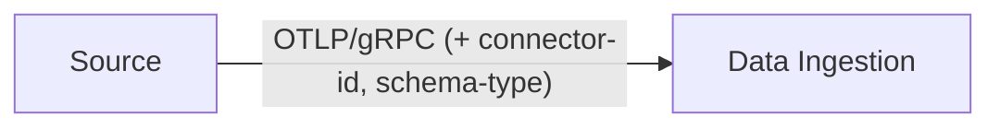
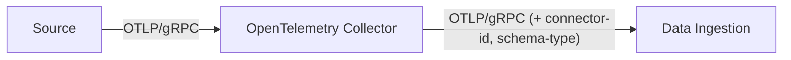

# OTLP Data Ingestion

## Abstract

This page describes the native OpenTelemetry Protocol (OTLP) write path into Data Ingestion
and the two topologies that reach it. For the shared gRPC metadata headers and connector
identity rules, see the [Ingestion protocol](ingestion-protocol.md).

Data Ingestion accepts OTLP over gRPC only. It does not accept OTLP over HTTP.

A connector reaches the OTLP path in one of two ways: it sends OTLP/gRPC directly, or it
sends OTLP/gRPC to one or more OpenTelemetry Collectors that forward the data to Data
Ingestion. Both ways deliver the same data to the same receiver. They differ only in where
the ingest metadata headers are set.

## Method 1 - native OTLP over gRPC

The source holds an OTLP/gRPC exporter and sends directly to Data Ingestion and sets the ingest metadata headers itself.



Use this method when the source already speaks OTLP/gRPC and can set its own export
headers.

Set the headers through the standard OpenTelemetry exporter header mechanism. With an
OpenTelemetry SDK, set `OTEL_EXPORTER_OTLP_HEADERS`:

```sh
OTEL_EXPORTER_OTLP_ENDPOINT=ingest:8080
OTEL_EXPORTER_OTLP_HEADERS=connector-id=f5-syslog-1,schema-type=ocg.otlp.logs,schema-version=1.0.0
```

- The source MUST send OTLP/gRPC to the Data Ingestion gRPC endpoint.
- The source MUST set `connector-id` as an export header unless mTLS supplies the identity
  through the client certificate CN.
- The source SHOULD set `schema-type` and `schema-version` as export headers when the
  stream does not match the signal default.

## Method 2 - OTLP Collector hop

The source sends OTLP/gRPC to an [OpenTelemetry Collector](https://opentelemetry.io/docs/collector/). The OpenTelemetry Collector forwards the data
to Data Ingestion over OTLP/gRPC and sets the ingest metadata headers on the forwarding hop.
The source itself sends no identity headers; the OpenTelemetry Collector owns them.

This method suits sources that cannot set gRPC export headers, or that sit behind an OpenTelemetry
Collector that already aggregates their telemetry.



The OpenTelemetry Collector receives OTLP/gRPC and exports OTLP/gRPC to Data Ingestion. This example
authenticates with mTLS, so the client certificate CN supplies the OpenTelemetry Collector identity and
the `connector-id` header stays commented out. Set headers on the `otlp` exporter - they map
directly to gRPC metadata on every exported request:

```yaml
receivers:
  otlp:
    protocols:
      grpc:
        endpoint: 0.0.0.0:4317

exporters:
  otlp:
    endpoint: ingest:8080
    compression: gzip
    tls:
      ca_file: /etc/otelcol/certs/ca.crt
      cert_file: /etc/otelcol/certs/collector.crt
      key_file: /etc/otelcol/certs/collector.key
    headers:
      # connector-id is omitted: mTLS supplies the identity through the client
      # certificate CN. Set connector-id only when the hop does not use mTLS.
      # connector-id: f5-syslog-1
      schema-type: ocg.otlp.logs

service:
  pipelines:
    logs:
      receivers: [otlp]
      exporters: [otlp]
```

## Choosing a method

| Factor                             | Native gRPC | OpenTelemetry Collector hop                |
| ---------------------------------- | ----------- | ------------------------------------------ |
| Source sets export headers         | Yes         | No - the OpenTelemetry Collector sets them |
| Extra component to operate         | None        | One or more OpenTelemetry Collectors       |
| Per-hop processing (batch, filter) | No          | Yes                                        |

- Use the native gRPC method when the source speaks OTLP/gRPC and can set its own headers.
- Use the OpenTelemetry Collector hop method when the source cannot set gRPC headers, or sits behind an
  OpenTelemetry Collector that already aggregates telemetry.
