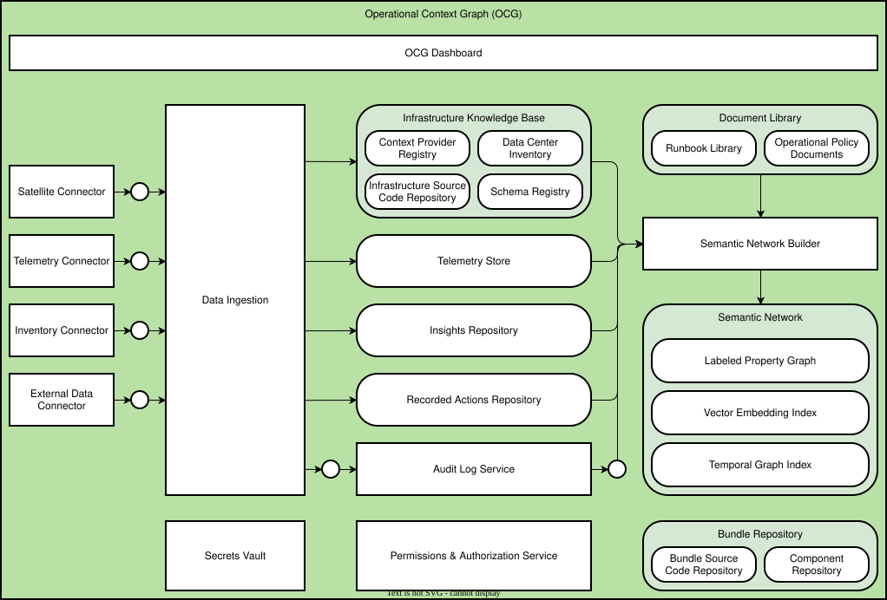

# Architecture Overview

The Operational Context Graph (OCG) is the single shared data store for a data center. This page describes the components that make it up.

## Overview Diagram

## Components

### OCG Dashboard

The dashboard is the primary user interface. It spans all OCG components and exposes their data to operators and automated agents.

### [Data Ingestion](./data-ingestion/)

Data Ingestion is the entry point for all external data. It receives raw data from the connectors and routes it to the appropriate store.

#### Connectors

Connectors integrate external systems with Data Ingestion. The OCG ships the following connector types:

| Connector               | Data it provides                  |
| ----------------------- | --------------------------------- |
| Satellite Connector     | Satellite and deployment metadata |
| Telemetry Connector     | Metrics, traces, and logs         |
| [Inventory Connector](./inventory-connector)     | Infrastructure inventory records  |
| External Data Connector | Other external data sources       |

### Infrastructure Knowledge Base

The Infrastructure Knowledge Base stores structured knowledge about the infrastructure. It contains four sub-components:

- **Context Provider Registry** - a registry of all providers that contribute context to the OCG
- **Infrastructure Source Code Repository** - the source code that describes infrastructure configuration
- **[Data Center Inventory](./inventory-store)** - records of physical and virtual data center assets
- **Schema Registry** - schemas for all data types the OCG manages

### Document Library

The Document Library stores operational documents. It contains:

- **Runbook Library** - step-by-step runbooks for operational tasks
- **Operational Policy Documents** - policies that govern infrastructure operations

### [Telemetry Store](./telemetry-store)

The Telemetry Store holds time-series metrics, logs, and traces from all data center systems.

### Insights Repository

The Insights Repository stores analysis results and recommendations. Analytics consumers write to it after processing OCG data.

### Recorded Actions Repository

The Recorded Actions Repository is an immutable, tamper-evident record of every manual and automated action taken on the infrastructure.

### Audit Log Service

The Audit Log Service records authentication, authorization, data access, and component lifecycle events.

### Semantic Network Builder

The Semantic Network Builder is a service that constructs the Semantic Network. It reads from the Infrastructure Knowledge Base, the Document Library, the Telemetry Store, the Insights Repository, and the Recorded Actions Repository.

### Semantic Network

The Semantic Network is the core of the OCG. It represents infrastructure resources and their relationships in three complementary indexes:

- **Labeled Property Graph** - a graph database of infrastructure resources and their typed relationships
- **Vector Embedding Index** - semantic embeddings that enable similarity search across resources
- **Temporal Graph Index** - a time-aware index that captures how the graph evolves over time

### Bundle Repository

The Bundle Repository stores deployable bundles. It contains:

- **Bundle Source Code Repository** - source code for OCG bundles
- **Component Repository** - individual reusable components that bundles depend on

### Cross-Cutting Services

Two services span the entire OCG:

- **Secrets Vault** - credentials, API keys, and certificates used by connectors and services
- **Permissions & Authorization Service** - controls access to all OCG components and data
