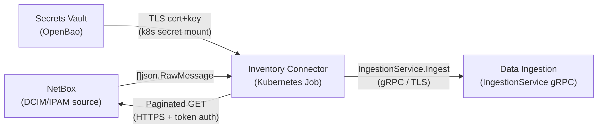
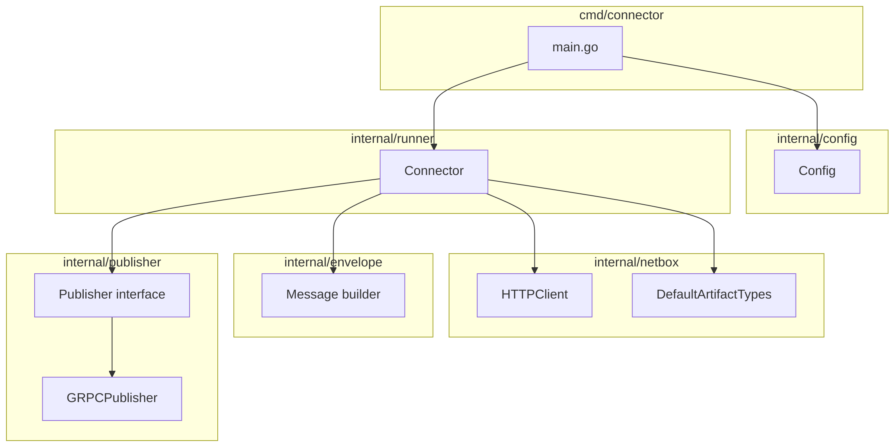
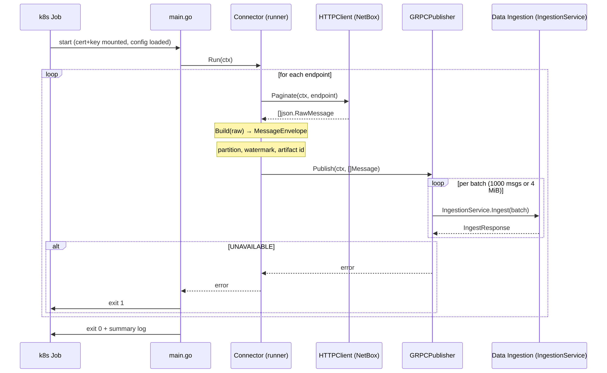

# Inventory Connector

The Inventory Connector ingests static or slowly changing asset data into the OCG. It reads from external inventory systems, transforms records into OCG-compatible representations, and writes them into the Infrastructure Knowledge Base through Data Ingestion. It keeps the central inventory synchronized with external systems of record.

For now the Inventory Connector reads raw inventory records from NetBox and delivers them to [Data Ingestion](./data-ingestion/) via the `IngestionService` gRPC interface.

The connector runs as a Kubernetes `Job`. Each run pages all configured NetBox endpoints, wraps each record in a `MessageEnvelope`, and publishes the batch. It covers the internal component structure, run sequence, partition and watermark shape, batching, authentication, observability, configuration, and deployment.

The connector does not manage watermarks itself. It embeds a partition key and a watermark value in each envelope and lets the OCG pipeline own the state.

## 1. Governing Decisions

### 1.1 Responsibility split

| Responsibility                                            | Owner                               |
| --------------------------------------------------------- | ----------------------------------- |
| Pagination and record retrieval from NetBox               | Inventory Connector                 |
| Envelope construction (partition, watermark, raw payload) | Inventory Connector                 |
| TLS client certificate authentication to Data Ingestion   | Inventory Connector                 |
| Schema validation and normalization                       | Data Ingestion                      |
| Watermark persistence and gap tracking                    | Data Ingestion                      |
| Retry on transient failure                                | Kubernetes Job controller (restart) |
| Durability (outbox)                                       | Data Ingestion                      |

### 1.2 Stateless batch job - no retry within a run

The connector is stateless. It makes no retry attempt within a run. Any fatal error - config load failure, publisher init failure, or `UNAVAILABLE` from Data Ingestion - causes an immediate `exit 1`. The Kubernetes Job controller handles retries by restarting the Job.

This keeps the run model simple and makes failures directly observable as Job restart events.

### 1.3 Partition and watermark shape

The `IngestionService` interface requires each `MessageEnvelope` to carry a `partition` and a `watermark`. The Connector uses the NetBox integer `id` as the watermark value, and the endpoint path as the partition key.

### 1.4 Structured logging with log/slog

The connector needs a structured logging library. The connector is a Kubernetes batch job that runs for seconds to minutes. High-throughput logging performance is not a requirement. It uses the standard Go library `log/slog` for logging.

## 2. Design Views

### 2.1 Context

The connector sits between NetBox and the OCG Data Ingestion service.

### 2.2 Composition

The connector is a single Go binary with the following internal packages:

| Package              | Responsibility                                                                                                                |
| -------------------- | ----------------------------------------------------------------------------------------------------------------------------- |
| `cmd/connector`      | Entry point. Loads config, wires dependencies, calls the runner, exits.                                                       |
| `internal/config`    | Reads and validates configuration from environment variables and mounted files.                                               |
| `internal/netbox`    | `HTTPClient` paginates a single NetBox endpoint. `DefaultArtifactTypes` maps each endpoint path to its logical artifact type. |
| `internal/envelope`  | Builds a `MessageEnvelope` from a raw JSON record. Extracts `id` for the watermark.                                           |
| `internal/runner`    | `Connector` iterates endpoints, calls the NetBox client, builds envelopes, and calls the publisher.                           |
| `internal/publisher` | `Publisher` interface with one production implementation: `GRPCPublisher`.                                                    |

### 2.3 Run sequence

Each run is a single pass over all configured endpoints. There is no partial retry - a failure at any point exits the run immediately.

### 2.4 Envelope batching

The `GRPCPublisher` accumulates envelopes and flushes each batch when either limit is reached:

- **1000 messages** per batch (record count limit)
- **4 MiB** per batch (size limit)

If Data Ingestion returns `UNAVAILABLE`, the run aborts and the Kubernetes Job controller retries the entire run.

### 2.5 Authentication and transport security

When `CONNECTOR_GRPC__CERT_FILE` and `CONNECTOR_GRPC__KEY_FILE` are set, the connector loads the X.509 client certificate and presents it on every gRPC call to Data Ingestion. Without them, the connection uses no TLS. The connector fails fast at startup if the files are configured but cannot be loaded.

NetBox communication uses HTTPS with a bearer token read from a mounted secret.

### 2.6 Observability

The connector uses `log/slog` from the Go standard library. All calls use structured key-value pairs - no format strings - so output is machine-parseable when a JSON handler is wired at startup.

| Level   | Emitted when                                                                                                               |
| ------- | -------------------------------------------------------------------------------------------------------------------------- |
| `Info`  | Connector start with config summary; per-endpoint completion with record count; connector finish with totals and duration. |
| `Warn`  | Individual envelope build failures (malformed records are skipped, not fatal).                                             |
| `Error` | Fatal errors before `os.Exit(1)`: config load failure, publisher init failure, endpoint failure.                           |

The exit code is the primary health signal for the Kubernetes Job controller.

### 2.7 Configuration

All configuration is read at startup via the `CONNECTOR_` environment variable prefix. The connector fails fast on any missing required value.

| Environment variable           | Required | Description                                                                                             |
| ------------------------------ | -------- | ------------------------------------------------------------------------------------------------------- |
| `CONNECTOR_NETBOX__BASE_URL`   | Yes      | Base URL of the NetBox instance.                                                                        |
| `CONNECTOR_NETBOX__TOKEN`      | No       | Bearer token for NetBox API authentication.                                                             |
| `CONNECTOR_NETBOX__PAGE_SIZE`  | Yes      | Records per page when paginating NetBox. Range: 1–10000.                                                |
| `CONNECTOR_GRPC__ENDPOINT`     | Yes      | Address of the Data Ingestion gRPC endpoint.                                                            |
| `CONNECTOR_GRPC__CONNECTOR_ID` | Yes      | Connector identity passed in each `MessageEnvelope`.                                                    |
| `CONNECTOR_GRPC__CERT_FILE`    | No       | Path to the TLS client certificate (Privacy Enhanced Mail (PEM) format).                                |
| `CONNECTOR_GRPC__KEY_FILE`     | No       | Path to the TLS client private key (PEM format).                                                        |
| `CONNECTOR_SCHEMA_VERSION`     | Yes      | Schema version to set on every envelope.                                                                |
| `CONNECTOR_ENDPOINTS`          | Yes      | Comma-separated list of NetBox endpoint paths to poll.                                                  |
| `CONNECTOR_ARTIFACT_TYPES`     | No       | JSON object mapping endpoint path to logical artifact type. Overrides `DefaultArtifactTypes` per entry. |

### 2.8 Deployment

The connector runs as a Kubernetes `Job`. The Job spec mounts the TLS client certificate and NetBox token as secrets and sets the environment variables from [§2.7](#27-configuration).

The Kubernetes Job controller handles retries. The connector itself makes no retry attempt within a run - any fatal error exits immediately. The connector listens for `SIGTERM` and `SIGINT` and stops cleanly between endpoints when one is received.

| Exit code | Meaning                                                                                         |
| --------- | ----------------------------------------------------------------------------------------------- |
| `0`       | All endpoints processed; summary log written.                                                   |
| `1`       | Fatal error: config load failure, publisher init failure, or `UNAVAILABLE` from Data Ingestion. |
