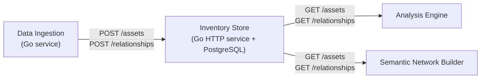
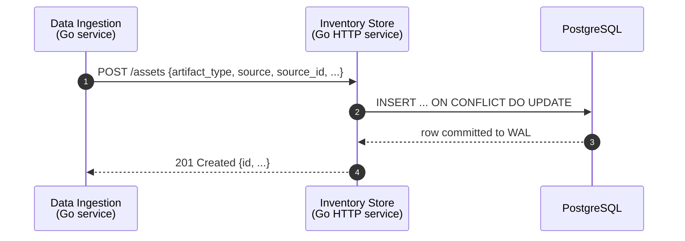
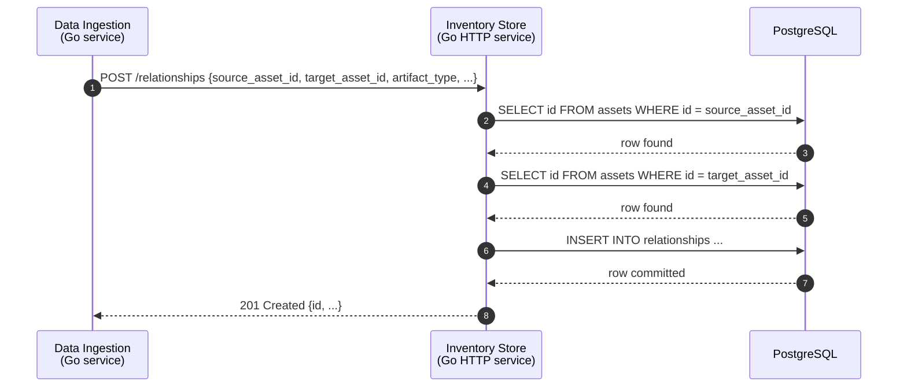
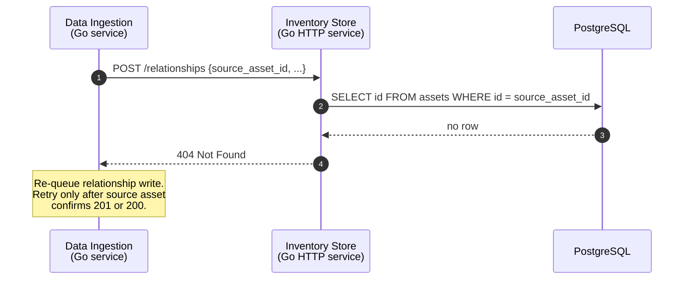
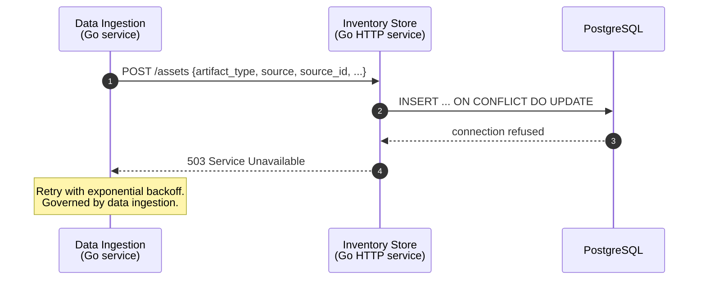
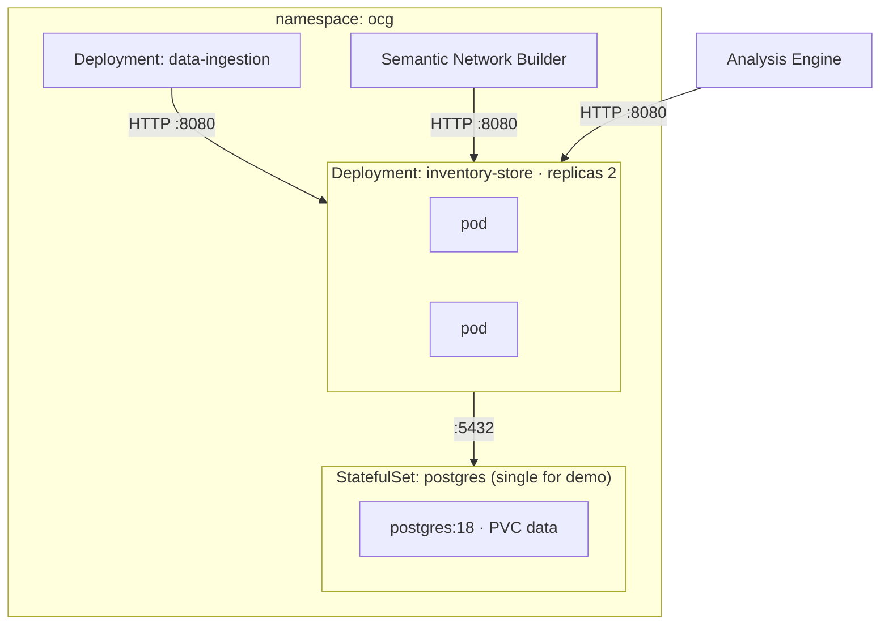

# Inventory Store

The Inventory Store is the sub-store within the Infrastructure Knowledge Base (IKB) that records data center assets and topology relationships. This document covers the data model, ingestion and read interfaces, deployment configuration, schema evolution, and connection pool sizing.

The store is written by Data Ingestion and read by the Analysis Engine and the Semantic Network Builder (SNB). It does not cover discovery mechanisms, backpressure handling, or graph database integration - those are Data Ingestion and SNB concerns.

Deduplication of incoming records is this store's responsibility. Row-level deduplication uses SQL upsert semantics - Data Ingestion does not need to track which records it has already sent. Temporal deduplication is handled by the Go service, which compares `last_updated_at_source` on each write before deciding whether to create a new version row.

## 1. Governing Decisions

### 1.1 Backpressure and durability live in Data Ingestion

Data Ingestion emits canonical JSON records and holds the outbox. It persists undelivered records, retries with backoff, and pauses when a store signals overload.

The Inventory Store therefore:

- **Does not buffer.** Nothing durable, nothing to lose on restart.
- **Does signal.** `503 Service Unavailable` when PostgreSQL is unreachable; `404 Not Found` when a relationship references an asset that has not been written yet. Data Ingestion acts on these signals.
- **Tolerates at-least-once delivery**, because upsert semantics (`ON CONFLICT DO UPDATE`) make re-delivery safe.

### 1.2 Store-specific wire protocols

There is no uniform protocol between Data Ingestion and the stores. Each store defines the ingestion API suited to its domain, and Data Ingestion holds a purpose-built client per store.

**Applied here:** the Inventory Store uses a REST/HTTP JSON API (see [§2.4](#_2-4-interface)). This is the correct choice because write frequency is low (minutes to hours between writes per connector), making the connection-pool and latency advantages of the native PostgreSQL wire protocol irrelevant. The REST API gives the store team control over upsert semantics, FK ordering, and validation.

### 1.3 Deduplication is the store's responsibility

In the OCG data ingestion flow, each store is responsible for detecting and discarding duplicate records. Data Ingestion does not deduplicate. It delivers each record at least once and relies on the store to handle re-delivery safely.

The Inventory Store satisfies this responsibility using SQL upsert semantics:

- **`POST /assets`** uses `ON CONFLICT (source_system, source_id) DO UPDATE`. If the same asset arrives twice, the second write updates the existing row. No duplicate row is created.
- **`POST /relationships`** uses `ON CONFLICT (source_asset_id, target_asset_id, artifact_type) DO NOTHING`. If the same edge arrives twice, the second write is silently dropped.
- **Batch endpoints** (`POST /assets/batch`, `POST /relationships/batch`) apply the same per-row conflict resolution within a single transaction.

This means Data Ingestion connectors can send full snapshots on reconnect without first checking what is already stored. The store absorbs re-delivery at no cost to the connector.

### 1.4 Responsibility split

| Responsibility                               | Owner           |
| -------------------------------------------- | --------------- |
| Canonical JSON emission                      | Data Ingestion  |
| Durability (outbox)                          | Data Ingestion  |
| Retry with backoff                           | Data Ingestion  |
| Circuit breaker / pause on overload          | Data Ingestion  |
| Write ordering (assets before relationships) | Data Ingestion  |
| Deduplication of incoming records            | Inventory Store |
| Upsert semantics, FK validation              | Inventory Store |
| `503` / `404` signal on failure              | Inventory Store |
| Read API                                     | Inventory Store |
| Schema migrations                            | Inventory Store |

## 2. Design Views

### 2.1 Context

The Inventory Store is a sub-store within the Infrastructure Knowledge Base. It has two external actors:

- **Data Ingestion** (Go service) - writes asset and relationship records via the REST API.
- **Consumers** (Analysis Engine, Semantic Network Builder) - read assets and relationships via the REST API.

The Inventory Store has no direct external dependencies on other OCG stores. It does not read from the Telemetry Store or the Semantic Network.



### 2.2 Composition

The Inventory Store consists of three components:

| Component           | Role                                                                                                                                             |
| ------------------- | ------------------------------------------------------------------------------------------------------------------------------------------------ |
| **Go HTTP service** | Handles all read and write requests. Translates REST calls to parameterized SQL. Reads the schema version on startup; does not apply migrations. |
| **Migrator**        | A separate binary that embeds the migration files and applies pending migrations as a Kubernetes Job before the Deployment rollout.              |
| **PostgreSQL**      | Stores assets and relationships. Enforces referential integrity via foreign keys. Provides WAL-backed durability.                                |

**How PostgreSQL handles replication.** PostgreSQL replication is server-side and invisible to the client. When Data Ingestion calls `POST /assets`, the Go HTTP service returns `201` or `200` only after PostgreSQL has written to its WAL on the primary node. Replication to standby nodes happens asynchronously after that WAL commit. The client receives no signal about standby lag.

This is safe for the Inventory Store for three reasons:

1. **Write frequency is low.** Assets and relationships are written on the timescale of minutes to hours, not per second. Replication lag of a few seconds carries negligible data-loss risk.
2. **Records are re-deliverable.** Data Ingestion connectors hold the source data. If a primary node fails before a standby catches up, the connector can re-ingest the missed records after failover. Upsert semantics (`ON CONFLICT DO UPDATE`) make re-delivery safe.
3. **The durability signal is the HTTP response.** A `201` or `200` means the primary committed the write to its WAL. No polling, label check, or semaphore is needed.

The practical implication: callers only need to track HTTP responses. The replication topology is entirely invisible to them.

PostgreSQL supports `synchronous_commit = on` for deployments that require zero data loss on failover. This setting blocks the primary until at least one standby acknowledges the write. It is a server-side deployment setting; the Go service and Data Ingestion require no changes.

### 2.3 Data model

The data model has two tables: `assets` and `relationships`.

#### `assets`

Each asset represents a single addressable entity in the data center - a server, a network device, a load balancer, a software component.

Fields from the OCG canonical data model are inherited at two levels:

- **`BaseModel` fields** (present on all OCG entities): `iri`, `artifact_type`, `source_system`, `extensions`, `ingested_at`
- **ChildModel fields** (persistent entities only): `source_id`, `created_at_source`, `last_updated_at_source`

Assets are persistent entities, so they inherit both tiers. The store uses `last_updated_at_source` to detect genuine updates: if the incoming value matches the current row, the write is a re-delivery and no new temporal row is created.

The store adds the following columns on top of the canonical model:

| Column       | Type          | Purpose                                                                                                                   |
| ------------ | ------------- | ------------------------------------------------------------------------------------------------------------------------- |
| `id`         | `UUID`        | Internal stable identifier. Assigned on first write, never changed. Used as the FK target in `relationships`.             |
| `created_at` | `TIMESTAMPTZ` | Wall clock time of first write to the store. Not updated on subsequent upserts. Used as the keyset cursor for pagination. |
| `valid_from` | `TIMESTAMPTZ` | Timestamp at which this version of the asset became current. Set on insert; never changed.                                |
| `valid_to`   | `TIMESTAMPTZ` | Timestamp at which this version was superseded, or `NULL` if this is the current version.                                 |

Natural key constraint: `UNIQUE (source_system, source_id)`.

Partial unique index: `UNIQUE (source_system, source_id) WHERE valid_to IS NULL`. This ensures the database enforces that exactly one current version row exists per asset at any time. The upsert must reference this index explicitly: `ON CONFLICT (source_system, source_id) WHERE valid_to IS NULL DO UPDATE`.

**Deduplication.** Assets are deduplicated at two levels:

- **Row-level.** `ON CONFLICT (source_system, source_id) WHERE valid_to IS NULL DO UPDATE` ensures no duplicate current rows exist. `id` is stable across re-deliveries and never changes.
- **Temporal.** Before inserting a new version row, the store compares the incoming `last_updated_at_source` against the current row. If the values match, the record is a re-delivery - the upsert refreshes the row but no new temporal entry is created. If `last_updated_at_source` advances, a new temporal row is inserted with `valid_from` set to the update timestamp and the previous row's `valid_to` closed.

#### `relationships`

Each row records a directed, typed edge between two assets.

Fields from the OCG canonical data model are inherited at two levels - `BaseModel` fields (`iri`, `artifact_type`, `source_system`, `extensions`, `ingested_at`) and ChildModel fields (`source_id`, `created_at_source`, `last_updated_at_source`). Relationships are persistent entities, so they inherit both tiers.

The store adds the following columns:

| Column            | Type          | Purpose                                                                         |
| ----------------- | ------------- | ------------------------------------------------------------------------------- |
| `id`              | `UUID`        | Internal stable identifier. Assigned on first write, never changed.             |
| `source_asset_id` | `UUID`        | FK to `assets.id` with `ON DELETE CASCADE`. The "from" end of the relationship. |
| `target_asset_id` | `UUID`        | FK to `assets.id` with `ON DELETE CASCADE`. The "to" end of the relationship.   |
| `created_at`      | `TIMESTAMPTZ` | Wall clock time of first write to the store.                                    |

Natural key constraint: `UNIQUE (source_asset_id, target_asset_id, artifact_type)`.

**Deduplication.** If the same edge arrives twice, `ON CONFLICT (source_asset_id, target_asset_id, artifact_type) DO NOTHING` silently drops the second write.

**Write ordering constraint:** Both assets referenced in a relationship must exist before the relationship is created. The FK constraint enforces this. The store returns `HTTP 404` if either asset is missing. Data Ingestion must write assets before writing their relationships.

**Deferred required columns.** The IKB spec requires several fields that are not in the current schema. They are absorbed into `extensions` for now and promoted to static columns in a future migration once their shape is stable:

| Field              | Spec requirement                                                             | Current handling                                        |
| ------------------ | ---------------------------------------------------------------------------- | ------------------------------------------------------- |
| `state`            | MUST track `active`, `maintenance`, `decommissioned`                         | Stored in `extensions.state`; no enforcement            |
| `location`         | MUST track hierarchical location within data center physical layout          | Stored in `extensions.location`; hierarchy not modelled |
| `firmware_version` | MUST track firmware versions, vendor mappings, lifecycle data                | Stored in `extensions`                                  |
| `telemetry_tier`   | MUST provide telemetry tier classification per asset                         | Stored in `extensions.telemetry_tier`                   |
| `protocol_support` | MUST store asset taxonomy including protocol support (SNMPv3, Redfish, etc.) | Stored in `extensions`                                  |

Promotion to static columns requires a migration and consumer coordination. The `JSONB` `extensions` column absorbs these fields in the interim without blocking ingestion.

**History.** The IKB requires complete change history with millisecond-precision timestamps and time-series versioning of topology changes. The `assets` table uses `valid_from` / `valid_to` temporal columns to satisfy this requirement (see [INV-DEC-002](#inv-dec-002-asset-history-temporal-columns-on-assets)). Each row represents one version of an asset. When an asset is updated, the current row's `valid_to` is set to the update timestamp and a new row is inserted with `valid_from` set to the same timestamp and `valid_to` set to `NULL`. The current state of an asset is the row where `valid_to IS NULL`. Deleted assets have `valid_to` set to the deletion timestamp and no successor row.

**Partitioning.** The `assets` table is the correct target for range partitioning by `valid_from`. It accumulates one row per write event and grows without bound. Partitioning by `valid_from` from the start allows old partitions to be dropped in a single metadata operation instead of a slow row-by-row `DELETE`. Retrofitting partitioning after data exists requires a full table rewrite, so the partition strategy must be in place before the first write.

### 2.4 Interface

The Inventory Store exposes a single REST/HTTP JSON API. All requests and responses use `Content-Type: application/json`.

#### Write endpoints (Data Ingestion)

```text
POST   /assets
POST   /assets/batch
POST   /relationships
POST   /relationships/batch
```

**`POST /assets` - upsert an asset**

`POST /assets` is idempotent. The store uses `ON CONFLICT (source_system, source_id) DO UPDATE` to update the existing row when the natural key matches. Data Ingestion always sends the full current record. It does not pre-check existence.

> **Note:** This endpoint uses upsert semantics - `POST` creates or replaces depending on whether the natural key `(source_system, source_id)` already exists. This is a deliberate deviation from strict REST. Data Ingestion never holds the internal UUID of an asset, so it cannot call a separate `PUT /{id}` endpoint without a prior lookup. The upsert contract eliminates that round-trip.

Request body:

```json
{
  "iri": "urn:ocg:asset/f5-connector-prod/ltm-virtual-vs_app_443",
  "artifact_type": "f5_load_balancer",
  "source_system": "f5-connector-prod",
  "source_id": "ltm/virtual/vs_app_443",
  "ingested_at": null,
  "extensions": {
    "name": "vs_app_443",
    "ip_addresses": ["10.0.1.5"],
    "partition": "Common",
    "pool": "pool_app"
  }
}
```

Response: `201 Created` on first write, `200 OK` on upsert update. The response body contains the full asset record including the assigned `id`.

**`POST /relationships` - create a relationship**

Request body:

```json
{
  "iri": "urn:ocg:rel/f5-octavia-topology-connector/3fa85f64-7cb91a23-routes_to",
  "source_asset_id": "3fa85f64-5717-4562-b3fc-2c963f66afa6",
  "target_asset_id": "7cb91a23-8812-4f11-a901-3c812e55bbf1",
  "artifact_type": "routes_to",
  "source_system": "f5-octavia-topology-connector",
  "ingested_at": null,
  "extensions": {}
}
```

Both `source_asset_id` and `target_asset_id` must be internal UUIDs returned by prior `POST /assets` calls.

`POST /relationships` is idempotent via `ON CONFLICT (source_asset_id, target_asset_id, artifact_type) DO NOTHING`. If the same edge arrives twice, the second write is silently dropped. The response is `200 OK`. The conflict target is the natural key only. `id` is excluded - it is a surrogate UUID assigned at creation time, and including it would prevent deduplication.

**`POST /assets/batch` - upsert multiple assets**

Accepts an array of asset objects in the request body. Each item follows the same shape as `POST /assets`. The store processes all items in a single transaction using `ON CONFLICT (source_system, source_id) DO UPDATE`. This is the preferred endpoint for initial load, when a connector sends a full inventory snapshot.

Response: `200 OK` with an array of results, one per input item, each containing the assigned `id` and the outcome (`created` or `updated`). If any item fails validation, the entire batch is rejected with `400 Bad Request` and no rows are written.

**`POST /relationships/batch` - create multiple relationships**

Accepts an array of relationship objects. Each item follows the same shape as `POST /relationships`. All items are processed in a single transaction. Duplicate edges within the batch or against existing rows are silently dropped via `ON CONFLICT DO NOTHING`.

Response: `200 OK`. If any `source_asset_id` or `target_asset_id` does not exist, the entire batch is rejected with `404 Not Found`.

#### Read endpoints (consumers)

```http
GET /assets/{id}
GET /assets[?type={type}][&source={source}][&source_id={id}][&limit={n}][&after={cursor}]
GET /relationships/{id}
GET /relationships[?asset_id={id}][&source_asset_id={id}][&target_asset_id={id}][&type={type}]
```

All read queries use indexed columns. See [§3.3](#_3-3-data-model) for index definitions.

`GET /assets` and `GET /relationships` each accept any combination of their filter parameters. Omitting all filters returns all records. Combining filters returns records that match all of them.

#### Pagination

The `GET /assets` list endpoint uses cursor-based pagination.

**Why cursor-based and not `LIMIT`/`OFFSET`.** `OFFSET N` requires PostgreSQL to scan and discard N rows before returning results - performance degrades linearly with page depth. It also produces skipped or duplicated rows if a write occurs between pages. A keyset cursor avoids both problems: it uses an index seek directly to the continuation point regardless of depth, and new writes (which have a later `created_at`) never disturb a page already retrieved.

**Cursor construction.** The cursor is a composite of `(created_at, id)`, encoded as an opaque base64 token in the response. The query:

```sql
WHERE (created_at, id) > ($cursor_time, $cursor_id)
ORDER BY created_at, id
LIMIT $page_size
```

Both columns are covered by a composite index on `(created_at, id)` to be added in a future migration.

**Request parameters:**

| Parameter | Description                                                              |
| --------- | ------------------------------------------------------------------------ |
| `limit`   | Page size. Default: `100`. Maximum: `1000`.                              |
| `after`   | Opaque cursor token returned by the previous page. Absent on first page. |

**Response shape:**

```json
{
  "items": [ ... ],
  "next_cursor": "MjAyNi0wOS0yOVQxMjowMDowMForeGZlZDEyMw=="
}
```

Absence of `next_cursor` indicates the last page. Point-lookup endpoints (`GET /assets/{id}`, `GET /relationships/{id}`) return a single object and do not paginate. When `source` and `source_id` are combined on `GET /assets`, the result set is at most one record - callers can treat this as a point lookup without needing a dedicated sub-resource.

#### Response codes

| HTTP status               | Condition                                                                                                                                                             |
| ------------------------- | --------------------------------------------------------------------------------------------------------------------------------------------------------------------- |
| `201 Created`             | Asset or relationship newly persisted.                                                                                                                                |
| `200 OK`                  | Existing asset updated on upsert.                                                                                                                                     |
| `400 Bad Request`         | Validation failure. Response body contains field-level errors.                                                                                                        |
| `404 Not Found`           | Referenced asset `id` does not exist (relationship write) or asset not found (read).                                                                                  |
| `409 Conflict`            | Relationship already exists. Callers should not reach this in normal operation because `POST /assets` is idempotent and relationship writes are not retried on `409`. |
| `503 Service Unavailable` | PostgreSQL unreachable.                                                                                                                                               |

### 2.5 Interaction

#### Happy path: asset write



#### Happy path: relationship write



#### Failure path: asset not found on relationship write

This happens when Data Ingestion writes a relationship before the source or target asset has been written. The correct action is to re-queue the relationship and retry after the asset write confirms `201` or `200`. This is a write-ordering issue, not a transient error.



#### Failure path: PostgreSQL unavailable

The store returns `503 Service Unavailable`. Data Ingestion owns retry, backoff, and circuit-breaker behaviour for this signal ([backlog#238](https://github.tools.sap/autonomous-operations/backlog/issues/238)).



On `400 Bad Request`: Data Ingestion logs field-level errors and routes the record to its dead-letter store. The Inventory Store does not retry.

There is no batching requirement. Each asset and each relationship is one request. Write frequency is too low to require buffering.

### 2.6 Deployment

#### Container layout

| Component                  | Image                                                        | Notes                                                                                |
| -------------------------- | ------------------------------------------------------------ | ------------------------------------------------------------------------------------ |
| `inventory-store`          | `ghcr.io/operational-context-graph/inventory-store`          | Go HTTP service; does not contain the migration library                              |
| `inventory-store-migrator` | `ghcr.io/operational-context-graph/inventory-store-migrator` | Migrator binary with embedded SQL files; run as a Kubernetes Job before each rollout |
| PostgreSQL (production)    | `apeiro/postgres:18-hardened`                                | Hardened image; build step required before deployment                                |

#### Kubernetes topology



**Not a DaemonSet.** All persistent state lives in the PostgreSQL PVC. The Go HTTP service is stateless between requests. Scale by request rate, not node count.

### 2.7 Algorithm - Schema Evolution

#### Change categories and cost

| Change                                             | PostgreSQL cost                                                                                          | Handling                                                                  |
| -------------------------------------------------- | -------------------------------------------------------------------------------------------------------- | ------------------------------------------------------------------------- |
| New nullable column on `assets` or `relationships` | Instant metadata operation in PostgreSQL 11+                                                             | PR + migration file; no data rewrite                                      |
| `VARCHAR` widened (e.g. `source_id` 256 → 512)     | Table rewrite on older versions; instant in PG 14+ for widening only                                     | PR + migration file; verify version                                       |
| `JSONB` field added to `extensions`                | No DDL needed - `extensions` absorbs new fields                                                          | No action; document in Schema Registry                                    |
| New index                                          | Non-blocking with `CREATE INDEX CONCURRENTLY`                                                            | PR + migration file                                                       |
| Column renamed                                     | Requires a multi-step approach (add → backfill → drop old)                                               | PR + migration file; coordinate with consumers                            |
| Column dropped                                     | Irrecoverable without backup restore                                                                     | PR + migration file + data review + consumer sign-off                     |
| Table added                                        | Instant                                                                                                  | PR + migration file                                                       |
| Table dropped                                      | Irrecoverable                                                                                            | PR + migration file + data review                                         |
| Table partitioned                                  | Requires converting the table to a partitioned parent + child partitions; existing data must be migrated | PR + migration file + maintenance window; coordinate with consumers       |
| `asset_history` table added                        | Append-only; range-partitioned by `changed_at` from the start                                            | PR + migration file; partition strategy must be agreed before first write |

**`JSONB` removes the coordination deadline for new source-specific fields.** If a connector adds a new field to its payload, it lands in `extensions` immediately without a schema change. Static columns are promoted only when the field is queried by the Analysis Engine or SNB and the performance difference justifies a migration.

#### Migration runner

The Inventory Store uses [Goose](https://github.com/pressly/goose) v3 as its schema migration tool.

**Tool integration.** The migrator binary calls Goose through the Provider API. It opens a `pgx` connection and passes the `*sql.DB` handle to `goose.NewProvider` - Goose imports no database driver of its own. The Go HTTP service does not link the Goose library. Its readiness check (`GET /healthz`) issues a plain `SELECT 1` with the read-only application account.

**Database bootstrap.** The application database is pre-created by the postgres image at cluster initialisation, before the first Job runs. The migrator connects directly to the application database and does not create it.

**Deployment pattern.** Migrations run as a Kubernetes Job (`inventory-store-migrator`) that completes before the `inventory-store` Deployment rolls out. The Job runs the migrator binary, which applies all pending migrations and exits. Service pods start only after the Job succeeds. The Job uses a dedicated DDL account with `CREATE`, `ALTER`, and `DROP` privileges. The long-lived service pods use a separate read-write account with no DDL privilege.

**File naming and format.** How migrations are versioned, applied, and run is set by the shared OCG migration tooling.

**Tracking table.** Goose records applied migrations in a `goose_db_version` table that it creates on first run.

**Failure handling.** A non-zero Job exit is a hard stop. The deployment pipeline must not proceed to the rollout and must require explicit remediation before the next migration run. Goose does not impose a dirty-state flag, so a failed migration can be retried after the fix without a manual `force` step.

### 2.8 Resources - Connection Pool and Concurrency

The Go HTTP service uses `pgx/v5` with `pgxpool` for connection pooling.

**Why a pool and not per-request connections.** PostgreSQL's process-per-connection model means each new connection spawns a backend process (~5–10 MB). At 25 concurrent HTTP handlers each opening a connection, that is 250 MB of process memory plus fork overhead. A pool of 25 connections is shared across all handlers. Handlers block briefly on checkout instead of paying the connect-plus-fork cost each time.

**Pool sizing.** The Inventory Store write rate is low (minutes to hours between writes from a single connector). 25 open connections is a conservative ceiling that fits within a standard `postgres:18` `max_connections = 100` default without coordination. If multiple `inventory-store` replicas share one PostgreSQL instance:

```text
total connections = replicas × DB_MAX_OPEN_CONNS  ≤  max_connections − 3  (superuser reserve)
```

For 2 replicas and the default `25`, the aggregate is 50, well within the default.

**Connection lifetime.** `DB_CONN_MAX_LIFETIME = 5m` prevents connections from aging past load balancer or firewall idle-timeout cutoffs. Without this setting, stale connections present as abrupt `EOF` errors on reuse. The pool reconnects automatically when a connection exceeds the lifetime.

**Idle connections.** `DB_MAX_IDLE_CONNS = 5` keeps a small warm pool ready for the next write burst without holding 25 backend processes open between infrequent writes.

## Non-functional Characteristics

### Security

- The `inventory-store` container runs as UID 1000 (non-root). The `postgres:18` image runs as the `postgres` user (UID 999) by default.
- `DATABASE_URL` must be supplied via a Kubernetes `Secret`. It must not appear in a `ConfigMap`, an environment literal in a manifest committed to source control, or in application logs.
- `DATABASE_URL` must include `?sslmode=verify-full` and a mounted CA certificate in production. Plain TCP connections are acceptable only in local development.
- `pg_hba.conf` must use `scram-sha-256` in production. `trust` and `md5` are acceptable only locally.
- The REST API has no authentication in the current milestone. Network-level isolation (Kubernetes namespace policy or service-mesh mTLS) is the only access control. Authentication must be resolved before production.

### Availability

- **Dev / single-instance:** One PostgreSQL pod, no standby. Any pod restart causes write unavailability until the pod is healthy and the `inventory-store` pool reconnects.
- **Production:** CloudNativePG or Zalando postgres-operator manages primary + standby topology and automatic failover. One primary failure is transparent to clients after failover completes (typically < 30 s with an operator). The `inventory-store` service reconnects automatically via pool reconnect logic.
- Two `inventory-store` replicas means one pod can restart or be evicted while the other continues serving requests. Three or more replicas are not required at current write rates.

### Scalability

- **Horizontal service scale:** Add `inventory-store` replicas. Each replica holds its own connection pool of `DB_MAX_OPEN_CONNS` connections. Respect the pool sizing formula: `replicas × DB_MAX_OPEN_CONNS ≤ max_connections − 3`.
- **PostgreSQL vertical scale:** Increase CPU and memory on the PostgreSQL node before adding replicas. The Inventory Store write rate is low; PostgreSQL rarely becomes the bottleneck before the connection limit is reached.
- **Read scale:** PostgreSQL standby nodes can serve read queries. If read traffic from the Analysis Engine or SNB grows, point those consumers at a read replica rather than the primary.
- **Graph query scale:** SQL joins on the `relationships` table support single-hop traversal at current scale. Multi-hop traversal at production asset counts requires a graph engine.

### Data Retention

- The `assets` table accumulates one row per write event (all versions, including expired ones). No automated TTL applies to current-state rows in the first version. A future version must add a configurable retention period enforced by a background cleanup job. A backlog item must be created to track the design and implementation of this feature.
- Old historical rows (where `valid_to` is not `NULL` and older than the retention window) are dropped by removing old range partitions. The retention window is controlled by the `INVENTORY_HISTORY_RETENTION_DAYS` environment variable (default `90`).
- The `relationships` table holds current state only and accumulates indefinitely.
