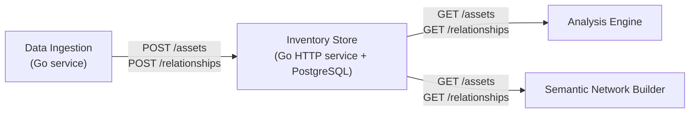
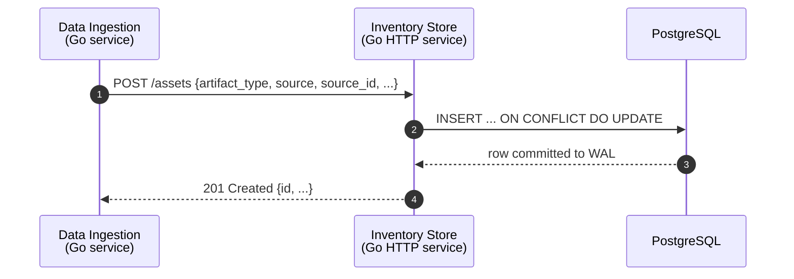
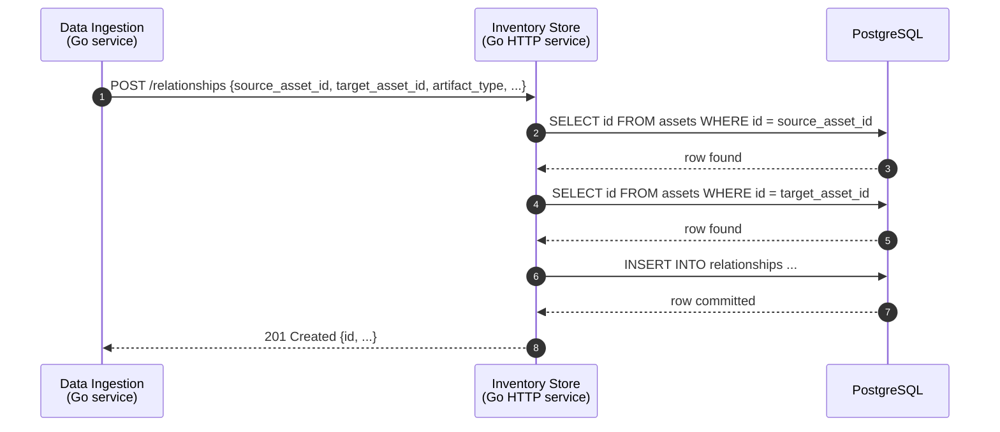
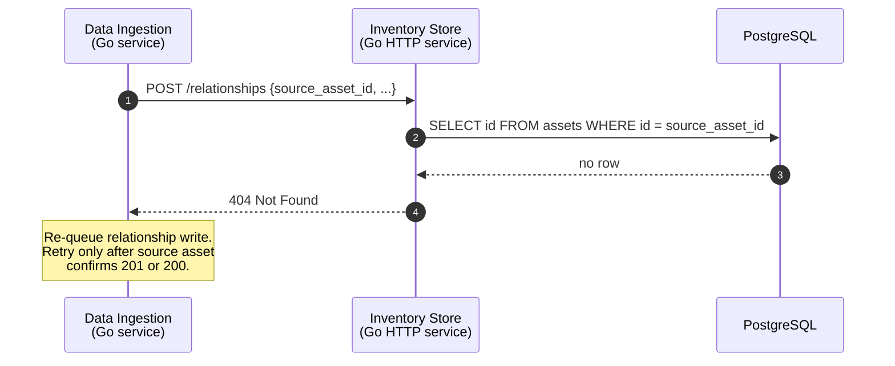
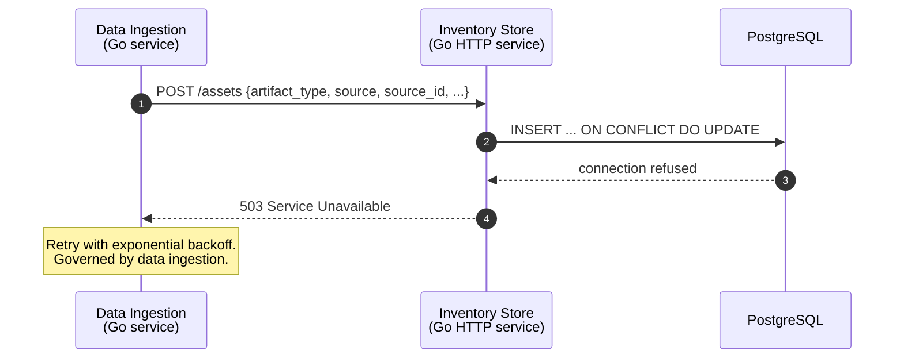

# Inventory Store

The Inventory Store is the sub-store within the Infrastructure Knowledge Base (IKB) that records data center assets and topology relationships. This document covers the data model, ingestion and read interfaces, deployment configuration, schema evolution, and connection pool sizing.

The store is written by Data Ingestion and read by the Analysis Engine and the Semantic Network Builder (SNB). It does not cover discovery mechanisms, backpressure handling, or graph database integration - those are Data Ingestion and SNB concerns.

Deduplication of incoming records is this store's responsibility. Row-level deduplication uses SQL upsert semantics of the relational database used by the store. The Data Ingestion component does not need to track which records it has already sent. Temporal deduplication is handled by the service, which compares the `last_updated_at_source` timestamp defined as part of the canonical data model on each write before deciding whether to create a new version row.

## 1. Governing Decisions

### 1.1 Backpressure and durability live in Data Ingestion

Data Ingestion emits canonical JSON records and holds the outbox. It persists undelivered records, retries with backoff, and pauses when a store signals overload.

The Inventory Store therefore:

- **Does not buffer.** Nothing durable, nothing to lose on restart.
- **Does signal.** `503 Service Unavailable` when PostgreSQL is unreachable; `404 Not Found` when a relationship references an asset that has not been written yet. Data Ingestion acts on these signals.
- **Tolerates at-least-once delivery**, because upsert semantics (`ON CONFLICT DO UPDATE`) make re-delivery safe.

### 1.2 Store-specific wire protocols

There is no uniform protocol between Data Ingestion and the stores. Each store defines the ingestion API suited to its domain, and Data Ingestion holds a purpose-built client per store.

**Applied here:** the Inventory Store uses a REST/HTTP JSON API (see [§2.4](#_2-4-interface)). This is the correct choice because write frequency is low (minutes to hours between writes per connector), making the connection-pool and latency advantages of the native PostgreSQL wire protocol irrelevant. The REST API gives the store team control over upsert semantics, FK ordering, and validation.

### 1.3 Deduplication is the store's responsibility

In the OCG data ingestion flow, each store is responsible for detecting and discarding duplicate records. Data Ingestion does not deduplicate. It delivers each record at least once and relies on the store to handle re-delivery safely.

The Inventory Store satisfies this responsibility using SQL upsert semantics:

- **`POST /assets`** uses `ON CONFLICT (source_system, source_id) DO UPDATE`. If the same asset arrives twice, the second write updates the existing row. No duplicate row is created.
- **`POST /relationships`** uses `ON CONFLICT (source_asset_id, target_asset_id, artifact_type) DO NOTHING`. If the same edge arrives twice, the second write is silently dropped.
- **Batch endpoints** (`POST /assets/batch`, `POST /relationships/batch`) apply the same per-row conflict resolution within a single transaction.

This means Data Ingestion connectors can send full snapshots on reconnect without first checking what is already stored. The store absorbs re-delivery at no cost to the connector.

### 1.4 Responsibility split

| Responsibility                               | Owner           |
| -------------------------------------------- | --------------- |
| Canonical JSON emission                      | Data Ingestion  |
| Durability (outbox)                          | Data Ingestion  |
| Retry with backoff                           | Data Ingestion  |
| Circuit breaker / pause on overload          | Data Ingestion  |
| Write ordering (assets before relationships) | Data Ingestion  |
| Deduplication of incoming records            | Inventory Store |
| Upsert semantics, FK validation              | Inventory Store |
| `503` / `404` signal on failure              | Inventory Store |
| Read API                                     | Inventory Store |
| Schema migrations                            | Inventory Store |

## 2. Design Views

### 2.1 Context

The Inventory Store is a sub-store within the Infrastructure Knowledge Base. It has two external actors:

- **Data Ingestion** (Go service) - writes asset and relationship records via the REST API.
- **Consumers** (Analysis Engine, Semantic Network Builder) - read assets and relationships via the REST API.

The Inventory Store has no direct external dependencies on other OCG stores. It does not read from the Telemetry Store or the Semantic Network.

### 2.2 Composition

The Inventory Store consists of these components:

| Component           | Role                                                                                                                                             |
| ------------------- | ------------------------------------------------------------------------------------------------------------------------------------------------ |
| **Go HTTP service** | Handles all read and write requests. Translates REST calls to parameterized SQL. Reads the schema version on startup; does not apply migrations. |
| **PostgreSQL**      | Stores assets and relationships. Enforces referential integrity via foreign keys. Provides WAL-backed durability.                                |

**How PostgreSQL handles replication.** PostgreSQL replication is server-side and invisible to the client. When Data Ingestion calls `POST /assets`, the Go HTTP service returns `201` or `200` only after PostgreSQL has written to its WAL on the primary node. Replication to standby nodes happens asynchronously after that WAL commit. The client receives no signal about standby lag.

This is safe for the Inventory Store for three reasons:

1. **Write frequency is low.** Assets and relationships are written on the timescale of minutes to hours, not per second. Replication lag of a few seconds carries negligible data-loss risk.
2. **Records are re-deliverable.** Data Ingestion connectors hold the source data. If a primary node fails before a standby catches up, the connector can re-ingest the missed records after failover. Upsert semantics (`ON CONFLICT DO UPDATE`) make re-delivery safe.
3. **The durability signal is the HTTP response.** A `201` or `200` means the primary committed the write to its WAL. No polling, label check, or semaphore is needed.

The practical implication: callers only need to track HTTP responses. The replication topology is entirely invisible to them.

PostgreSQL supports `synchronous_commit = on` for deployments that require zero data loss on failover. This setting blocks the primary until at least one standby acknowledges the write. It is a server-side deployment setting; the Go service and Data Ingestion require no changes.

### 2.3 Interaction

#### Happy path: asset write

#### Happy path: relationship write

#### Failure path: asset not found on relationship write

This happens when Data Ingestion writes a relationship before the source or target asset has been written. The correct action is to re-queue the relationship and retry after the asset write confirms `201` or `200`. This is a write-ordering issue, not a transient error.

#### Failure path: PostgreSQL unavailable

The store returns `503 Service Unavailable`. Data Ingestion owns retry, backoff, and circuit-breaker behaviour for this signal ([backlog#238](https://github.tools.sap/autonomous-operations/backlog/issues/238)).

On `400 Bad Request`: Data Ingestion logs field-level errors and routes the record to its dead-letter store. The Inventory Store does not retry.

There is no batching requirement. Each asset and each relationship is one request. Write frequency is too low to require buffering.
