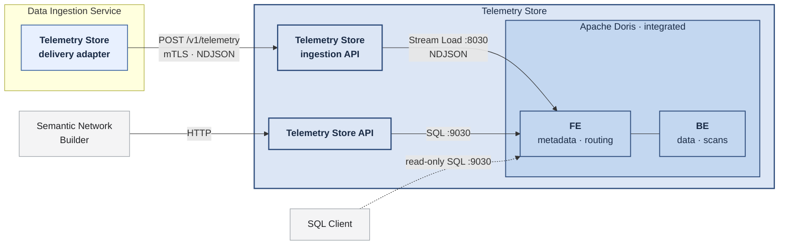
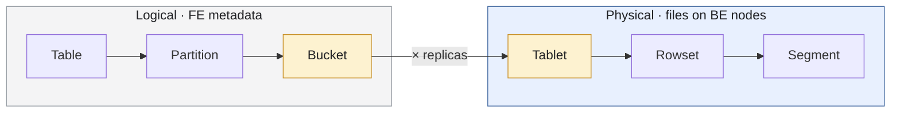
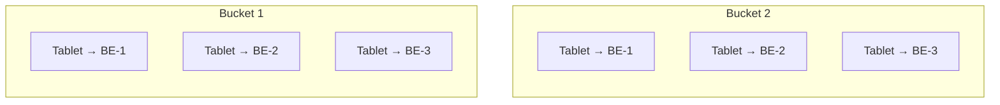
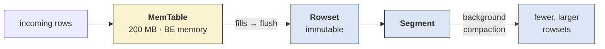
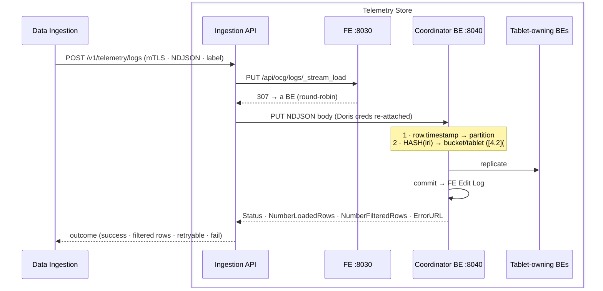
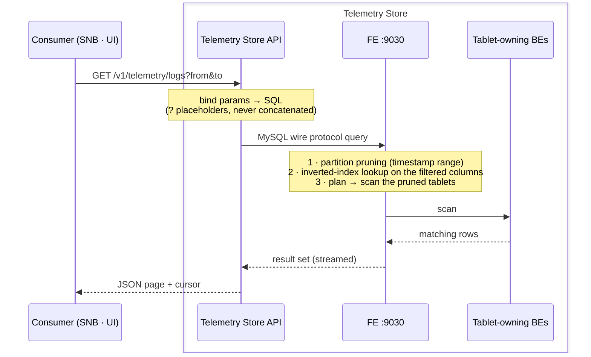
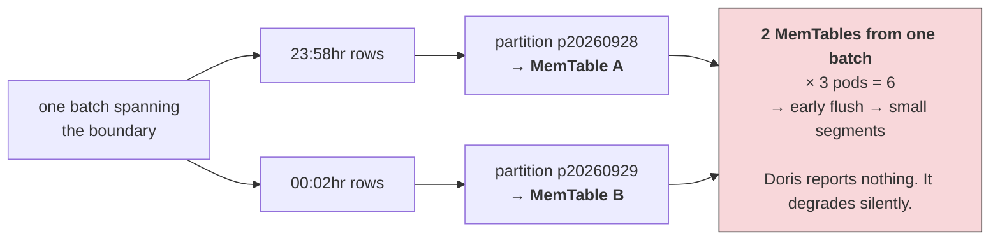
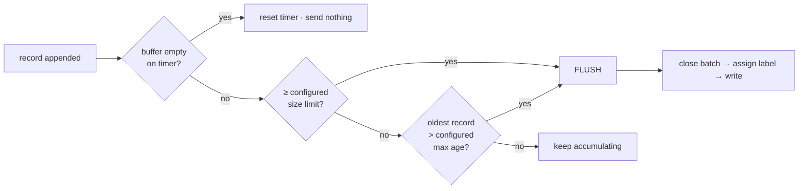

# Telemetry Store

The Telemetry Store holds time-series operational telemetry. This documentation describes its design: Apache Doris,its DDL and Read/Write APIs. The store holds canonical log, metric, and trace records and makes them queryable.

## 1. System overview



Doris speaks **HTTP Stream Load** for writes and the **MySQL wire protocol** for reads. Data Ingestion calls the store's ingestion API; the store writes into Doris over Stream Load ([AD3](#ad3-a-telemetry-store-ingestion-api-in-front-of-doris)).

| Responsibility                                                              | Owner           |
| --------------------------------------------------------------------------- | --------------- |
| Canonical JSON, validation, normalisation, audit                            | Data Ingestion  |
| Durability, retry, backpressure, batch forming                              | Data Ingestion  |
| Label generation per batch; writing the batch to the store                  | Data Ingestion  |
| Ingestion API: Stream Load mechanics, 307 handling, Doris write credentials | Telemetry Store |
| Storage schema: DDL, partitioning, bucketing, retention, VARIANT            | Telemetry Store |
| Read path: the Telemetry Store API                                          | Telemetry Store |
| Partition routing, bucketing, replication, commit at load time              | Telemetry Store |

## 2. Architectural decisions

What each architectural decision means for this store:

### AD1 Per-store ingestion APIs, purpose-built adapters

Data Ingestion has a purpose-built delivery adapter per store, each implementing a shared store-writer interface. For this store it is the **Telemetry Store delivery adapter**.

### AD2 Back-pressure and durability live in Data Ingestion

Durability, retry, and back-pressure are Data Ingestion's, not the store's. The store does not persist, buffer, or re-send on Data Ingestion's behalf.

### AD3 A Telemetry Store ingestion API in front of Doris

The store fronts Doris with an ingestion API; Data Ingestion does not write to the Doris FE.This store's ingestion API mimics Doris Stream Load rather than converting to another shape. Data Ingestion `POST`s each batch to `/v1/telemetry/{logs|metrics|traces}` and authenticates . The store owns the Stream Load mechanics (307 follow, headers, `label`, `Status` parsing, `NumberFilteredRows`, Group Commit avoidance, `-235`) and is the only holder of the Doris write credentials. The store maps the load outcome into its response so Data Ingestion can decide retry and back-off.

### AD4 Doris version and image hardening

Doris 4.1.x is pinned. Production uses a hardened Doris image to address security concerns.

### AD5 The store deduplicates observations

The store handles deduplication, keyed on the record's `iri` column, which the Schema Registry supplies. This design must follow that requirement; it is implemented with a Doris **Unique Key** table ([4.2](#_4-2-bucketing-hash-on-iri), [4.6](#_4-6-shared-properties)), which also shapes bucketing and batching ([6](#_6-batching)).

## 3. Apache Doris concepts

| Node   | Role                                                                                 |
| ------ | ------------------------------------------------------------------------------------ |
| **FE** | Metadata, SQL parsing, query planning, Stream Load redirect. **Never touches data.** |
| **BE** | Data plane: stores tablets, executes scans, writes MemTables.                        |

### 3.1 Logical and physical



| Level         | What it is                                                                | Determines                             |
| ------------- | ------------------------------------------------------------------------- | -------------------------------------- |
| **Table**     | schema and key model                                                      | column types, sort order               |
| **Partition** | horizontal slice by `timestamp`                                           | query pruning, TTL, lifecycle          |
| **Bucket**    | logical slot inside a partition — hash of a key, or random                | where a row is routed                  |
| **Tablet**    | one physical shard per bucket, per replica                                | replication, compaction, parallel scan |
| **Rowset**    | one per MemTable flush, immutable                                         | —                                      |
| **Segment**   | columnar file: column pages, ZoneMap, BloomFilter, inverted index, footer | what a scan actually reads             |

**Bucket and tablet are the same shard under two names.**

### 3.2 Sizing calculations

```text
replica copies = partitions × buckets × 3      ← files on disk
```

#### 3.2.1 Replica placement



The FE scheduler enforces anti-affinity: **no two replicas of the same bucket land on the same BE node.** Three replicas survive two simultaneous node failures.

|              | Controls        | When the cluster grows                                 |
| ------------ | --------------- | ------------------------------------------------------ |
| **Replicas** | fault tolerance | **leave at 3** — see [3.2.3](#_3-2-3-fixed-constants)  |
| **Buckets**  | parallelism     | **scaling knob** — new BE nodes join the parallel scan |

#### 3.2.2 Inside one tablet



Every load flushes a MemTable and produces a rowset; compaction merges rowsets into fewer, larger segments in the background.

Small frequent loads flush tiny segments → compaction falls behind → the BE rejects writes with `-235`. Because each tablet holds **one active MemTable**, the number of tablets a single load touches drives BE memory directly. HASH bucketing ([AD5](#ad5-the-store-deduplicates-observations), [4.2](#_4-2-bucketing-hash-on-iri)) spreads one batch across every bucket in the partition, so a load touches many tablets and flushes many MemTables — the batching contract ([6](#_6-batching)) bounds the count.

#### 3.2.3 Fixed constants

Two values are fixed by design; everything else — partition granularity, bucket count, BE node count — is derived or measured.

|              | Value                                        | Why fixed                                                                                                                                      |
| ------------ | -------------------------------------------- | ---------------------------------------------------------------------------------------------------------------------------------------------- |
| **Replicas** | **3**                                        | Industry standard; raising it multiplies storage, write amplification and metadata load.                                                       |
| **TTL**      | **Configurable** (`dynamic_partition.start`) | Retention boundary. The default example uses `-6`, keeping offsets −6…0 inclusive — the past six days plus today = 7 days. Set per deployment. |

#### 3.2.4 Choosing bucket count

Two principles; **when they conflict, size wins.**

|     | Principle    | Rule                                                                                                                                                               |
| --- | ------------ | ------------------------------------------------------------------------------------------------------------------------------------------------------------------ |
| 1   | **Size**     | 1–10 GB **compressed** per tablet. The ≤ 10 GB bound is mandatory for Unique Key tables, which this design uses ([AD5](#ad5-the-store-deduplicates-observations)). |
| 2   | **Quantity** | bucket count a multiple of BE node count, so data spreads evenly.                                                                                                  |

Hard ceiling: **128 buckets per partition.** Beyond that, partition more finely instead.

> **Sizing is on compressed size.** With `compression = zstd` on text-heavy log bodies, the raw daily figure is not the number to divide. Measure with `SHOW DATA` and divide by the replica count for the logical size.

Doris's own recommendation, indexed by **compressed data per partition** (with daily partitioning, per day):

| Compressed per partition | Recommended buckets         |
| ------------------------ | --------------------------- |
| < 1 GB                   | 1                           |
| 1 – 10 GB                | 10                          |
| 10 – 200 GB              | 10 – 20                     |
| > 200 GB                 | partition more finely first |

<details>
<summary><b>Worked examples — A (small site) and B (large site)</b></summary>

Each example runs the two principles from [3.2.4](#_3-2-4-choosing-bucket-count): pick a bucket count that is an **integer multiple of the BE node count** (even distribution), then **check the resulting tablet size** lands in 1–10 GB compressed. Where they conflict, size wins.

> **The multiplier is a choice, not a formula.** Any multiple of the BE count is valid; the examples pick one that centres tablet size inside the range. In Example A, `3 · 1 = 3` buckets (≈3.3 GB/tablet), `3 · 2 = 6` (≈1.7 GB), and `3 · 3 = 9` (≈1.1 GB) all satisfy both principles — `6` is chosen for headroom, not because Doris requires `×2`.

**A — small site: 3 BE nodes, 10 GB/day compressed:**

```text
Step 1 — hardware:   3 BE nodes × 2           =   6 buckets   (×1→3, ×2→6, ×3→9 all valid; ×2 for headroom)
Step 2 — size check: 10 GB / 6                =   1.7 GB per tablet   within 1–10 GB
Step 3 — logical:    6 buckets                =   6 logical tablets per partition
Step 4 — on disk:    6 × 3 replicas           =  18 replica copies per partition
Step 5 — per node:   18 / 3 BE nodes          =   6 copies per node
Step 6 — retained:   start=-6 → offsets -6..0 =   7 populated partitions
                     + 1 pre-created (end=1)  =   8 dynamic partitions
Step 7 — steady:     18 × 7 populated         = 126 replica copies per table
                                              = 378 across three tables
Storage:  10 GB × 7 partitions × 3 replicas   = 210 GB on disk per table
```

**B — large site: 8 BE nodes, 160 GB/day compressed:**

Here the size principle leads: divide daily volume by the 10 GB target _first_, then confirm the result is a multiple of the BE count.

```text
Step 1 — size first: 160 GB / 10 GB target    =  16 buckets
Step 2 — hardware:   16 is a multiple of 8    = both principles agree
Step 3 — logical:    16 buckets               =  16 logical tablets per partition
Step 4 — on disk:    16 × 3 replicas          =  48 replica copies per partition
Step 5 — per node:   48 / 8 BE nodes          =   6 copies per node
Step 6 — retained:   start=-6 → offsets -6..0 =   7 populated partitions
                     + 1 pre-created (end=1)  =   8 dynamic partitions
Step 7 — steady:     48 × 7 populated         = 336 replica copies per table
                                              = 1,008 across three tables
Storage: 160 GB × 7 partitions × 3 replicas   = 3.36 TB on disk per table
```

Both land at six replica copies per node. Step 2 divides by _buckets_, not by replica copies: the 1–10 GB rule is stated on the logical tablet. Both bucket counts (6 and 16) stay well under the 128-per-partition ceiling.

</details>

<details>
<summary><b>What the TTL does to this math</b></summary>

Buckets are **per partition**, so the seven retained days spread across seven populated partitions, each with its own bucket set — retention never concentrates into one. Partition granularity sets per-partition size; TTL only bounds how many partitions exist.

With `start = -6, end = 1` there are **8 dynamic partitions** — 7 populated (offsets −6…0) plus 1 empty pre-created (offset +1) — so the steady-state totals use the 7 populated partitions:

| TTL fixes                | Formula                                                                                                                                                          |
| ------------------------ | ---------------------------------------------------------------------------------------------------------------------------------------------------------------- |
| Populated partitions     | `\|start\| + 1` → `6 + 1 = 7`                                                                                                                                    |
| Replica copies per table | buckets × replicas × populated partitions                                                                                                                        |
| Total storage on disk    | daily volume × populated partitions × replicas                                                                                                                   |
| The ceiling on both      | without a TTL, partitions accumulate forever — a year in, 365 partitions and (at 16 buckets × 3) **17,520 replica copies** per table holding data nobody queries |

**A wrong bucket count is survivable.** A partition's bucket count cannot change once created, but `dynamic_partition.buckets` applies to _newly created_ partitions, and existing ones age out:

```text
day 0   change dynamic_partition.buckets from 6 to 16
day 1   new partition created with 16 buckets; older 6-bucket partitions untouched
…
day 7   the oldest 6-bucket partition ages past offset -6 and drops
        → every live partition is now 16 buckets: no migration, no backfill
```

**A seven-day TTL means a bucket-count mistake self-corrects within a week.** This does _not_ extend to partition granularity or key columns, which cannot change without a table rebuild.

</details>

**Verify the sizing once data flows:**

```sql
SHOW TABLETS FROM ocg.logs;   -- per-tablet size
SHOW DATA;                     -- table size; divide by replica count for logical size
```

[Determine bucket count](https://doris.apache.org/docs/4.x/table-design/data-partitioning/data-bucketing) · [Design recommendations](https://doris.apache.org/docs/4.x/table-design/data-partitioning/basic-concepts) · [Dynamic partitioning](https://doris.apache.org/docs/4.x/table-design/data-partitioning/dynamic-partitioning)

Partition granularity and daily volume set the batching contract in [6](#_6-batching).

## 4. The DDL

### Relationship to the Doris OTel exporter model

Apache Doris publishes a reference observability data model in the OpenTelemetry Collector [`dorisexporter`](https://github.com/open-telemetry/opentelemetry-collector-contrib/tree/main/exporter/dorisexporter): table-per-signal DDL for logs, traces, and metrics. The schema here follows its shape where that shape fits — `DATETIME(6)` event time, range partitioning on `timestamp`, separate VARIANT columns for resource-scope and record-scope attributes, inverted indexes, and the OLAP engine.

It deviates on these points:

- **Source.** The exporter is fed by the OpenTelemetry Collector OTLP pipeline; this store is fed by Data Ingestion's canonical records. OTLP-shaped columns the exporter carries (`scope_name`, `scope_version`, `service_instance_id`, `exemplars`, and the `events` / `links` `ARRAY<STRUCT>` columns) do not map here directly and are not reproduced.
- **Key model and dedup.** The exporter uses `DUPLICATE KEY` with `DISTRIBUTED BY RANDOM` and keeps every row; the OTLP pipeline is at-least-once and carries no record identity, so it does not deduplicate. This store uses `UNIQUE KEY(timestamp, iri)` with `DISTRIBUTED BY HASH(iri)` and deduplicates on `iri` ([AD5](#ad5-the-store-deduplicates-observations)).
- **Batching and partitions.** The exporter's `DISTRIBUTED BY RANDOM` tables support `load_to_single_tablet`: each batch goes to one tablet, touching one MemTable regardless of how many partition boundaries the batch spans. This store uses HASH bucketing, which does not support `load_to_single_tablet`; each batch spreads across every bucket and each partition boundary in the batch activates an additional set of MemTables ([4.2](#_4-2-bucketing-hash-on-iri), [6.2](#_6-2-partition-boundaries)).
- **Record identity.** The exporter defines no record identity column. This store requires `iri` as the dedup and keyset-pagination key.
- **Metrics layout.** The exporter splits metrics across five tables by OTLP point type (gauge, sum, histogram, exponential histogram, summary). This store reads Prometheus gauges and counters through Data Ingestion and stores them in one `ocg.metrics` table ([4.4](#_4-4-ocg-metrics)); histograms and summaries are out of scope.

If a deployment ingests directly from OTLP consumers rather than from Data Ingestion, the operator should consider deploying the Doris OTel exporter instead. That changes the DDL documented here.

### 4.1 Principles

1. **Minimal static columns.** A static column commits to a field name in the canonical model. A field is static only when the store partitions, sorts, indexes, joins, or aggregates on it; everything else stays in VARIANT.
2. **Everything else in VARIANT.** New canonical fields land there with no DDL, migration, or redeployment.
3. **`timestamp`, `iri`, and the key model are the irreversible choices.** The partition key (`timestamp`), the Unique Key columns (`timestamp, iri`), and Merge-on-Write are fixed at table creation ([AD5](#ad5-the-store-deduplicates-observations), [7](#_7-changing-the-schema)). Every other column can be added later as a metadata-only `ALTER TABLE ADD COLUMN` under `light_schema_change`.
4. **Inverted indexes only.** No BloomFilter, per the Doris observability reference designs.
5. **Per-signal fields are promoted from `extensions`.** The signal-defining columns below (`severity`, `body`, `metric_name`, `value`, the trace columns) are not separate model fields; they arrive inside the record's `extensions` map, and the store promotes the known per-signal set to static columns at load time (8). Unpromoted `extensions` fields stay in VARIANT.

### 4.2 Bucketing: HASH on `iri`

Dedup drives the bucketing. The Unique Key dedup ([AD5](#ad5-the-store-deduplicates-observations)) requires a Unique Key table, and Doris supports RANDOM bucketing on Duplicate Key tables only — a Unique Key table must use HASH bucketing. The tables use `DISTRIBUTED BY HASH(iri)`, hashing on the Unique Key's identity column.

HASH bucketing cannot use `load_to_single_tablet` (that header is settable only on random-bucketed tables). So one batch spreads across every bucket in its partition:

```text
HASH(iri), no load_to_single_tablet:  1 batch → partition → tablets 0..N  → N MemTables  (early-flush pressure)
```

Each tablet holds one active MemTable ([3.2.2](#_3-2-2-inside-one-tablet)), so a load flushes as many MemTables as there are buckets. The batching contract ([6](#_6-batching)) bounds this by batch size and bucket count.

**Read cost:** HASH on `iri` prunes on the bucket key only for `iri`-equality lookups. Time-range and attribute queries do not filter on `iri`, so they scan all buckets in the matched partitions. Partition pruning still applies; within a partition, filtering falls to the inverted indexes.

[Data bucketing](https://doris.apache.org/docs/4.x/table-design/data-partitioning/data-bucketing) · [Unique Key model](https://doris.apache.org/docs/4.x/table-design/data-model/unique) · [Log storage](https://doris.apache.org/docs/4.x/observability/log) · [Trace storage](https://doris.apache.org/docs/4.x/observability/trace)

### 4.3 `ocg.logs`

Full DDL: [Appendix A → ocg.logs](#appendix-ocg-logs).

| Column                | Meaning                                                                                                                                   | Example                                | Index                                        |
| --------------------- | ----------------------------------------------------------------------------------------------------------------------------------------- | -------------------------------------- | -------------------------------------------- |
| `timestamp`           | Event time, UTC, microsecond precision (OTel `time_unix_nano`). Not collection or ingest time.                                            | `2026-09-29 10:40:54.123456`           | partition + sort key                         |
| `iri`                 | Unique identity of the record, from the registry contract. The Unique Key dedup column ([AD5](#ad5-the-store-deduplicates-observations)). | `urn:ocg:log:opensearch:a1b2c3`        | key + bucket key                             |
| `observed_timestamp`  | When the record was observed, if different from event time (OTel `observed_time_unix_nano`). Nullable.                                    | `2026-09-29 10:40:55.000000`           | —                                            |
| `host_name`           | Machine, node or device the line came from (OTel `host.name`). Joins to the Data Center Inventory Physical/Logical asset where applicable | `node-07`                              | inverted                                     |
| `severity`            | `TRACE` `DEBUG` `INFO` `WARN` `ERROR` `FATAL`, normalised from the source.                                                                | `ERROR`                                | inverted                                     |
| `body`                | Log line text after normalisation strips the source's structural wrapper.                                                                 | `connection refused to 10.0.3.42:6443` | inverted, `parser=unicode`, `support_phrase` |
| `resource_attributes` | Resource-scope attributes, as nested JSON: the entity that produced the record — service, pod, namespace, container, source system.       | `{"k8s.pod.name":"octavia-api-7d9f"}`  | —                                            |
| `attributes`          | Record-scope attributes, as nested JSON: per-observation fields, trace correlation, schema revision, future fields.                       | `{"http.status_code":500}`             | —                                            |

### 4.4 `ocg.metrics`

Full DDL: [Appendix A → ocg.metrics](#appendix-ocg-metrics).

| Column                | Meaning                                                                                                                                   | Example                          | Index                |
| --------------------- | ----------------------------------------------------------------------------------------------------------------------------------------- | -------------------------------- | -------------------- |
| `timestamp`           | When the sample was taken. Prometheus scrape time.                                                                                        | `2026-09-29 10:40:54.000000`     | partition + sort key |
| `iri`                 | Unique identity of the record, from the registry contract. The Unique Key dedup column ([AD5](#ad5-the-store-deduplicates-observations)). | `urn:ocg:metric:prom:d4e5f6`     | key + bucket key     |
| `observed_timestamp`  | When the sample was observed, if different from the scrape time. Nullable.                                                                | `2026-09-29 10:40:55.000000`     | —                    |
| `host_name`           | The machine the metric is about. Prometheus `instance`, port stripped. Same value space as `ocg.logs.host_name`.                          | `node-07`                        | inverted             |
| `metric_name`         | What is measured. Prometheus `__name__`.                                                                                                  | `node_memory_MemAvailable_bytes` | inverted             |
| `value`               | The measurement. Prometheus emits strings; normalisation parses to a number.                                                              | `3847291392`                     | —                    |
| `resource_attributes` | Resource-scope attributes: the entity the metric is about — job, source system.                                                           | `{"job":"node-exporter"}`        | —                    |
| `attributes`          | Record-scope attributes: remaining labels, unit.                                                                                          | `{"unit":"bytes"}`               | —                    |

`value` is a static `DOUBLE` because aggregation requires a numeric type; a VARIANT path needs a CAST on every query and stores numbers as DOUBLE internally with possible precision loss.

**Scope:** gauges and counters. Histograms and summaries carry bucket structures that do not fit this shape.

### 4.5 `ocg.traces`

Full DDL: [Appendix A → ocg.traces](#appendix-ocg-traces).

| Column                | Meaning                                                                                                                                   | Example                            | Index                |
| --------------------- | ----------------------------------------------------------------------------------------------------------------------------------------- | ---------------------------------- | -------------------- |
| `timestamp`           | Span start. End is `timestamp + duration_nanos`.                                                                                          | `2026-09-29 10:40:54.123456`       | partition + sort key |
| `iri`                 | Unique identity of the record, from the registry contract. The Unique Key dedup column ([AD5](#ad5-the-store-deduplicates-observations)). | `urn:ocg:span:otel:7a8b9c`         | key + bucket key     |
| `observed_timestamp`  | When the span was observed, if different from the span start. Nullable.                                                                   | `2026-09-29 10:40:55.000000`       | —                    |
| `host_name`           | The machine the span executed on. Same value space as logs and metrics.                                                                   | `node-07`                          | inverted             |
| `trace_id`            | Shared by every span in one distributed request. 32 hex chars.                                                                            | `4bf92f3577b34da6a3ce929d0e0e4736` | inverted             |
| `span_id`             | This span's own identifier. 16 hex chars, unique within the trace.                                                                        | `00f067aa0ba902b7`                 | inverted             |
| `parent_span_id`      | The span that called this one. Empty for the root.                                                                                        | `a2fb4a1d1a96d312`                 | —                    |
| `span_name`           | The operation this span represents.                                                                                                       | `GET /v1/pools`                    | inverted             |
| `duration_nanos`      | Span duration in nanoseconds.                                                                                                             | `142000000`                        | —                    |
| `status_code`         | `OK`, `ERROR`, `UNSET`.                                                                                                                   | `ERROR`                            | —                    |
| `resource_attributes` | Resource-scope attributes: the entity the span executed on — service, source system.                                                      | `{"service.name":"octavia-api"}`   | —                    |
| `attributes`          | Record-scope attributes: span kind, HTTP method, status message, events, links.                                                           | `{"span.kind":"server"}`           | —                    |

Traces carry more static columns because a call tree cannot be reconstructed without `trace_id`, `span_id` and `parent_span_id` as typed fields. `duration_nanos` is static so range filters work without a CAST; `status_code` is unindexed — three values, cheap to scan within a pruned partition.

### 4.6 Shared properties

| Property                              | Reason                                                                                                                                                                                                                                                                                                                                                                                                               |
| ------------------------------------- | -------------------------------------------------------------------------------------------------------------------------------------------------------------------------------------------------------------------------------------------------------------------------------------------------------------------------------------------------------------------------------------------------------------------- |
| `UNIQUE KEY(timestamp, iri)`          | Dedup: at most one row per `(timestamp, iri)` ([AD5](#ad5-the-store-deduplicates-observations)). The key also defines sort order and the prefix index. `timestamp` leads so it stays the partition key; `iri` is the identity column. The key cannot be `iri` alone — Doris requires the partition column in the key — and the pair dedups the same as `iri`, since an observation's `timestamp` is fixed per `iri`. |
| Merge-on-Write                        | Doris default for Unique Key; resolves duplicates at write time for read performance. Fixed at table creation — cannot change later ([7](#_7-changing-the-schema)).                                                                                                                                                                                                                                                  |
| `PARTITION BY RANGE(timestamp)`       | Time-range queries prune whole partitions. `timestamp` is part of the Unique Key, which Doris requires of the partition key.                                                                                                                                                                                                                                                                                         |
| `DISTRIBUTED BY HASH(iri) BUCKETS 10` | [4.2](#_4-2-bucketing-hash-on-iri). Unique Key forbids RANDOM bucketing.                                                                                                                                                                                                                                                                                                                                             |
| `compression = zstd`                  | Better ratio than default on text-heavy content.                                                                                                                                                                                                                                                                                                                                                                     |
| `compaction_policy = time_series`     | Append-heavy tuning; each rowset compacts once, not repeatedly. **To validate on a Unique Key Merge-on-Write table** — `time_series` targets append-only workloads.                                                                                                                                                                                                                                                  |
| `light_schema_change = true`          | Makes `ALTER TABLE ADD COLUMN` metadata-only.                                                                                                                                                                                                                                                                                                                                                                        |
| `dynamic_partition.start`             | Retention boundary ([3.2.3](#_3-2-3-fixed-constants)).                                                                                                                                                                                                                                                                                                                                                               |
| `replication_num = 3`                 | Fixed ([3.2.3](#_3-2-3-fixed-constants)). **Must be 1 on a single-BE dev cluster** or `CREATE TABLE` fails — parameterised per environment.                                                                                                                                                                                                                                                                          |

### 4.7 VARIANT

`resource_attributes` and `attributes` are `VARIANT`, not opaque JSON. Doris parses each JSON leaf path, picks the narrowest fitting type, and promotes frequent paths to subcolumns encoded like static columns — so a field is queryable per-path at near-static-column speed, and a first-time field needs no `ALTER TABLE`. Reading a VARIANT subcolumn is 6–11% slower than a static column and 0.8% larger.

**One rule: a path must have the same type in every record that lands in the same VARIANT column.** The conflict is _within one table_.

```text
some log records   {"http.status_code": 500}     ← number
other log records  {"http.status_code": "500"}   ← string
```

Doris cannot reconcile these, stores `http.status_code` as JSONB, and any index on that path is lost permanently — with NO error raised. Enforced at the source (D2), monitored via `variant_jsonb_fallback_total`.

[VARIANT](https://doris.apache.org/docs/4.x/sql-manual/basic-element/sql-data-types/semi-structured/VARIANT/) · [Type conflicts](https://doris.apache.org/docs/4.x/sql-manual/basic-element/sql-data-types/semi-structured/VARIANT/#type-conflicts-and-promotion-rules)

## 5. Read / Write APIs

### 5.1 Write — the ingestion API



**The store handles the FE's redirect to a BE.** The FE returns a `307` to a BE and leaves the data path; the body then streams to that BE. The ingestion API re-attaches the Doris credentials on the redirected request and knows the BE topology, so Data Ingestion never sees Doris ports or the redirect.

Data Ingestion sends NDJSON to the store with the batch `label`. The store sends the body to Doris with headers `format: json`, `read_json_by_line: true`, `strip_outer_array: false`, unchanged.

Two layers of idempotency apply and do not overlap ([AD5](#ad5-the-store-deduplicates-observations)): the `label` makes one batch commit at most once on retry; the Unique Key makes one `iri` exist at most once across all batches, so a record resent in a different batch does not duplicate.

The store speaks Stream Load to Doris and reads Doris's own request and response contract. It then maps the outcome into the ingestion API response Data Ingestion reads.

<details>
<summary><b>Request — Data Ingestion to store, then store to Doris</b></summary>

Data Ingestion posts the formed batch to the store with its `label`:

```http
POST /v1/telemetry/logs HTTP/1.1
Host: telemetry-store
Content-Type: application/x-ndjson
X-OCG-Label: logs-2026-09-29-a1b2c3d4        # batch label, deterministic from batch contents
# Data Ingestion auth: mTLS client certificate or bearer token

{"timestamp":"2026-09-29 10:40:54.123456","iri":"urn:ocg:log:opensearch:a1b2c3","host_name":"node-07","severity":"ERROR","body":"connection refused","resource_attributes":{"k8s.pod.name":"octavia-api-7d9f"},"attributes":{"http.status_code":500}}
{"timestamp":"2026-09-29 10:40:54.234567","iri":"urn:ocg:log:opensearch:a1b2c4","host_name":"node-07","severity":"WARN","body":"retrying","resource_attributes":{},"attributes":{}}
```

The store issues the Stream Load to Doris, re-attaching the Doris credentials across the 307 and passing Data Ingestion's label through:

```http
PUT /api/ocg/logs/_stream_load HTTP/1.1
Host: <fe>:8030
Authorization: Basic <ocg_writer>          # held by the store, re-attached across the 307
Expect: 100-continue
format: json
read_json_by_line: true                     # NDJSON: one object per line
strip_outer_array: false
label: logs-2026-09-29-a1b2c3d4             # forwarded from Data Ingestion
```

The store does not set `load_to_single_tablet`: the Unique Key tables use HASH bucketing, which does not support it ([4.2](#_4-2-bucketing-hash-on-iri)).

</details>

<details>
<summary><b>Doris response — always HTTP 200; the outcome is in the JSON body</b></summary>

Stream Load returns **HTTP 200 even when the load failed**. The outcome is the `Status` field, and partial loss appears inside an otherwise-successful load as `NumberFilteredRows > 0`. The store parses the body, never the HTTP status, and then maps the result into its own ingestion API response.

```json
{
  "TxnId": 45032,
  "Label": "logs-2026-09-29-a1b2c3d4",
  "Status": "Success",
  "NumberTotalRows": 482016,
  "NumberLoadedRows": 482013,
  "NumberFilteredRows": 3,
  "NumberUnselectedRows": 0,
  "LoadBytes": 91238401,
  "LoadTimeMs": 1840,
  "ErrorURL": "http://<be>:8040/api/_load_error_log?file=..."
}
```

| Field                | Why the store reads it · how it surfaces to Data Ingestion                                                                                        |
| -------------------- | ------------------------------------------------------------------------------------------------------------------------------------------------- |
| `Status`             | the true outcome — `Success`, `Publish Timeout`, `Label Already Exists`, `Fail`; the store maps it to a success or retryable or terminal response |
| `Label`              | echo of Data Ingestion's label; must **not** start with `group_commit_` ([6.2](#_6-2-partition-boundaries))                                       |
| `NumberFilteredRows` | `> 0` inside a `Success` is silent data loss; the store returns the filtered count to Data Ingestion and alerts                                   |
| `NumberLoadedRows`   | returned to Data Ingestion to reconcile against the batch's record count                                                                          |
| `ErrorURL`           | per-row rejection detail; the store fetches it on any filtered rows                                                                               |
| `TxnId`              | one per load, not per row — cannot serve as a row identity (D5)                                                                                   |

</details>

[Stream Load](https://doris.apache.org/docs/4.x/data-operate/import/import-way/stream-load-manual) · [JSON format](https://doris.apache.org/docs/4.x/data-operate/import/file-format/json)

### 5.2 Read — the Telemetry Store API



The **Telemetry Store API** is a Go service that fronts Doris and exposes the read path as a REST API. The consumer never speaks SQL (direct SQL access on FE is available if needed). The service translates the HTTP query into a parameterised SQL statement, sends it to Doris over the MySQL wire protocol (`:9030`), receives the result rows back over that protocol, and serialises them to JSON for the response.

Reads use the **MySQL wire protocol on 9030**, not the FE HTTP query API.

|                   | HTTP :8030                                     | MySQL :9030         |
| ----------------- | ---------------------------------------------- | ------------------- |
| Parameter binding | none — raw SQL string only (injection surface) | `?` placeholders    |
| Result delivery   | whole set buffered as one JSON document        | streamed row by row |
| Production use    | documented as unstable, developer testing only | standard            |

The HTTP query API is a candidate if it matures out of its developer-testing status.

**Endpoints:**

```http
GET /v1/telemetry/logs?from=…&to=…&host_name=…&severity=…&limit=…&cursor=…
GET /v1/telemetry/traces/{trace_id}
GET /v1/telemetry/metrics?metric_name=…&from=…&to=…&limit=…&cursor=…
```

**`from` and `to` are optional and default to a bounded window.** When either is absent the store applies a default range — for example, the last 5 minutes ending now — so a query never scans every retained partition.

**The other filters are optional with no default.** `host_name` and `severity` on logs, and `metric_name` on metrics, narrow the result when supplied; when absent the store does not filter on that field.

**Pagination uses a keyset cursor on `(timestamp, iri)`, not an offset** — `timestamp` alone is not unique within a partition. A UI tolerates a rare boundary duplicate, but the Semantic Network Builder pulling deltas must not miss or double-count, so it relies on the full `(timestamp, iri)` cursor and on `iri` being present (8).

[MySQL protocol](https://doris.apache.org/docs/4.x/connection-integration/mysql-proto)

[Arrow Flight SQL](https://doris.apache.org/docs/4.x/connection-integration/arrow-flight-sql)

## 6. Batching

### 6.1 Why Data Ingestion must batch

Each Stream Load is one transaction: an FE Edit Log write plus a MemTable flush producing a rowset ([3.2.2](#_3-2-2-inside-one-tablet)). The store expects **hundreds of MB to several GB** per batch, so Data Ingestion accumulates records before forming one.

### 6.2 Partition boundaries

Data Ingestion forms large batches and sends each under a stable label ([6.1](#_6-1-why-data-ingestion-must-batch)).

Not enforcing partition boundaries is acceptable, but has a performance cost. Doris routes every row to its partition by `timestamp` regardless of how the batch was formed, so correctness is unaffected. The cost is a batch spanning two partitions activates one MemTable per touched tablet in each partition ([3.2.2](#_3-2-2-inside-one-tablet)). That raises BE memory use and can trigger early flushes, producing smaller segments and more compaction work.  
[Load best practices — batching strategy](https://doris.apache.org/docs/4.x/data-operate/import/load-best-practices#batching-strategy)



If the cost proves significant, batches can be split by UTC day. Two implementation options:

1. **In the Telemetry Store Delivery Adapter .** The adapter already holds each record in canonical form including `timestamp`, so grouping a batch by day adds negligible cost. Each day is sent as its own request under a label derived from the original batch label and the day (`{signal}-{yyyy-mm-dd}-{batch_id}`), keeping retries idempotent.
2. **In the Telemetry Store ingestion API.** Possible, but the API would have to parse every NDJSON line to read its `timestamp` and buffer the whole batch before loading. That adds parsing and memory overhead to a component that otherwise streams the request body directly to Doris, solely to recover information the adapter already has.

The idempotency mechanism this store cares about is the **batch label**:

| Field       | Purpose                                                                                                                                                                                                                                                                                                                                                                                                                                               |
| ----------- | ----------------------------------------------------------------------------------------------------------------------------------------------------------------------------------------------------------------------------------------------------------------------------------------------------------------------------------------------------------------------------------------------------------------------------------------------------- |
| batch label | The batch's identity, derived deterministically from the batch contents, so a retry of the same batch reuses the same label. Data Ingestion sends it as the `X-OCG-Label` header on the POST; the store forwards it as the Doris Stream Load `label`. Doris persists it as the transaction key and dedups on it: a retry under the same label commits at most once (`202`, no duplicate rows). Doris echoes the label back; it does not mint its own. |

> **Setting a label opts out of Group Commit.** Doris can merge concurrent small loads server-side, but specifying a `label` takes the regular path: a Group Commit load returns its own `group_commit_…` label belonging to the merged transaction, which breaks retry dedup (C2). At this batch size Group Commit gives nothing (its advantage runs from 10 KB to ~1 MB and is gone by 10 MB). The store **does not set the `group_commit` header or `group_commit_mode` property at all** — configured alongside a label they do nothing. [Group Commit](https://doris.apache.org/docs/4.x/data-operate/import/load-best-practices/group-commit-manual)

### 6.3 Flush triggers



| Trigger     | Value                                  | Purpose                                |
| ----------- | -------------------------------------- | -------------------------------------- |
| Size        | Configurable (default example: 500 MB) | throughput                             |
| Max age     | Configurable (default example: 30 s)   | bounds ingest lag                      |
| Empty guard | skip                                   | an empty PUT still opens a transaction |

**Which trigger dominates depends on daily volume** (examples use the default values of 500 MB and 30 s):

| Site | Volume     | 500 MB trigger fires | Dominant trigger                                         |
| ---- | ---------- | -------------------- | -------------------------------------------------------- |
| A    | 10 GB/day  | every ~72 min        | **max-age (30 s)** — batches ≈ 3.5 MB, ~2,880 loads/day  |
| B    | 160 GB/day | every ~4.5 min       | **size (500 MB)** — ~320 loads/day, max-age rarely fires |

- **At low volume the store takes many small loads.** ~3.5 MB is far below the hundreds-of-MB guidance but far above the KB scale that causes `-235`; at 10 GB/day there is not enough data to outrun compaction. A batch at the day boundary spans two partitions and flushes twice as many MemTables, but at this volume the extra flush still produces segments well within what compaction handles. This trades batch efficiency for freshness, bounding ingest lag for incident response.
- **At high volume the size trigger does the work** and the contract behaves as Doris intends.

**Batch size versus MemTables.** The BE MemTable is 200 MB by default. HASH bucketing spreads one batch across every bucket in its partition ([4.2](#_4-2-bucketing-hash-on-iri)), so a 500 MB batch (the default size limit) into 10 buckets flushes about 10 MemTables of roughly 50 MB each. Bucket count sets how many MemTables a load flushes, so keep bucket count aligned to volume ([3.2.4](#_3-2-4-choosing-bucket-count)) to avoid tiny-segment flushes and the `-235` pressure they cause.

If measured volume lands far from these examples, revisit **both** [3.2.4](#_3-2-4-choosing-bucket-count) and the 7.B contract together.

### 6.4 Concurrency

Two per-BE limits bound Stream Load concurrency:

- `webserver_num_workers` — **128**, the recommended per-BE concurrency.
- `doris_max_remote_scanner_thread_pool_thread_num` — **512**, the hard per-BE limit.

Exceeding the hard limit may hang the BE process. The FE round-robins redirects, so loads spread across BEs — but the aggregate is what matters:

```text
total in-flight = client workers × per-worker concurrency
aggregate target 32 ÷ 4 Data Ingestion pods = 8 per pod
```

The binding constraint is aggregate compaction throughput, far below 128. Bounding the aggregate is Data Ingestion's job; no single pod sees the cluster-wide in-flight count, and back-pressure is per-request, so only the pod whose call failed learns anything. How Data Ingestion coordinates a shared budget is an open implementation question (10.1).

[Batching strategy](https://doris.apache.org/docs/4.x/data-operate/import/load-best-practices#batching-strategy) · [Stream Load concurrency](https://doris.apache.org/docs/4.x/data-operate/import/load-best-practices#stream-load-concurrency)

## 7. Changing the schema

| Change                                            | Cost                                         | Mechanism                        |
| ------------------------------------------------- | -------------------------------------------- | -------------------------------- |
| New field → VARIANT                               | none                                         | automatic — no DDL, no downtime  |
| New nullable static column                        | metadata-only (`light_schema_change`)        | `ALTER TABLE ADD COLUMN`         |
| VARCHAR widened                                   | rewrites data                                | `ALTER TABLE MODIFY COLUMN`      |
| Type changed / column dropped                     | heavy / irrecoverable                        | `ALTER TABLE`; review data first |
| `time_unit` changed                               | forward-only; existing partitions not re-cut | `ALTER TABLE` property change    |
| Bucket count, strategy, key columns, or key model | not an ALTER — new table + backfill          | new table + backfill             |

The key model (Unique Key), the Merge-on-Write choice, and the key columns `(timestamp, iri)` are fixed at table creation ([AD5](#ad5-the-store-deduplicates-observations), [4.1](#_4-1-principles)). Changing any of them is a new table plus backfill, not an `ALTER`.

**VARIANT removes the migration ordering constraint.** Without it, every store at every site would have to migrate _before_ Data Ingestion picked up a release, or fields would be dropped.

## Appendix A — Table DDL

<a id="appendix-ocg-logs"></a>

<details>
<summary><b>ocg.logs</b></summary>

```sql
CREATE TABLE IF NOT EXISTS ocg.logs (
  `timestamp`            DATETIME(6)   NOT NULL,
  `iri`                  VARCHAR(512)  NOT NULL,
  `observed_timestamp`   DATETIME(6)   NULL,
  `host_name`            VARCHAR(256)  NULL,
  `severity`             VARCHAR(16)   NULL,
  `body`                 TEXT          NULL,
  `resource_attributes`  VARIANT       NULL,
  `attributes`           VARIANT       NULL,

  INDEX idx_host_name (`host_name`) USING INVERTED,
  INDEX idx_severity  (`severity`)  USING INVERTED,
  INDEX idx_body      (`body`)      USING INVERTED
  PROPERTIES("parser" = "unicode", "support_phrase" = "true")
  )
  ENGINE = OLAP
  UNIQUE KEY(`timestamp`, `iri`)
  PARTITION BY RANGE(`timestamp`) ()
  DISTRIBUTED BY HASH(`iri`) BUCKETS 10
  PROPERTIES (
               "compression"                       = "zstd",
               "compaction_policy"                 = "time_series",  -- validate on Unique Key MoW (10.2)
               "light_schema_change"               = "true",
               "replication_num"                   = "3",
               "dynamic_partition.enable"          = "true",
               "dynamic_partition.time_unit"       = "DAY",
               "dynamic_partition.start"           = "-6",
               "dynamic_partition.end"             = "1",
               "dynamic_partition.prefix"          = "p",
               "dynamic_partition.buckets"         = "10",
               "dynamic_partition.replication_num" = "3"
             );
```

</details>

<a id="appendix-ocg-metrics"></a>

<details>
<summary><b>ocg.metrics</b></summary>

```sql
CREATE TABLE IF NOT EXISTS ocg.metrics (
  `timestamp`            DATETIME(6)   NOT NULL,
  `iri`                  VARCHAR(512)  NOT NULL,
  `observed_timestamp`   DATETIME(6)   NULL,
  `host_name`            VARCHAR(256)  NULL,
  `metric_name`          VARCHAR(256)  NULL,
  `value`                DOUBLE        NULL,
  `resource_attributes`  VARIANT       NULL,
  `attributes`           VARIANT       NULL,

  INDEX idx_host_name   (`host_name`)   USING INVERTED,
  INDEX idx_metric_name (`metric_name`) USING INVERTED
  )
  ENGINE = OLAP
  UNIQUE KEY(`timestamp`, `iri`)
  PARTITION BY RANGE(`timestamp`) ()
  DISTRIBUTED BY HASH(`iri`) BUCKETS 10
  PROPERTIES (
               "compression"                       = "zstd",
               "compaction_policy"                 = "time_series",  -- validate on Unique Key MoW (10.2)
               "light_schema_change"               = "true",
               "replication_num"                   = "3",
               "dynamic_partition.enable"          = "true",
               "dynamic_partition.time_unit"       = "DAY",
               "dynamic_partition.start"           = "-6",
               "dynamic_partition.end"             = "1",
               "dynamic_partition.prefix"          = "p",
               "dynamic_partition.buckets"         = "10",
               "dynamic_partition.replication_num" = "3"
             );
```

</details>

<a id="appendix-ocg-traces"></a>

<details>
<summary><b>ocg.traces</b></summary>

```sql
CREATE TABLE IF NOT EXISTS ocg.traces (
  `timestamp`            DATETIME(6)   NOT NULL,
  `iri`                  VARCHAR(512)  NOT NULL,
  `observed_timestamp`   DATETIME(6)   NULL,
  `host_name`            VARCHAR(256)  NULL,
  `trace_id`             VARCHAR(32)   NULL,
  `span_id`              VARCHAR(16)   NULL,
  `parent_span_id`       VARCHAR(16)   NULL,
  `span_name`            VARCHAR(256)  NULL,
  `duration_nanos`       BIGINT        NULL,
  `status_code`          VARCHAR(16)   NULL,
  `resource_attributes`  VARIANT       NULL,
  `attributes`           VARIANT       NULL,

  INDEX idx_trace_id  (`trace_id`)  USING INVERTED,
  INDEX idx_span_id   (`span_id`)   USING INVERTED,
  INDEX idx_host_name (`host_name`) USING INVERTED,
  INDEX idx_span_name (`span_name`) USING INVERTED
  )
  ENGINE = OLAP
  UNIQUE KEY(`timestamp`, `iri`)
  PARTITION BY RANGE(`timestamp`) ()
  DISTRIBUTED BY HASH(`iri`) BUCKETS 10
  PROPERTIES (
               "compression"                       = "zstd",
               "compaction_policy"                 = "time_series",  -- validate on Unique Key MoW (10.2)
               "light_schema_change"               = "true",
               "replication_num"                   = "3",
               "dynamic_partition.enable"          = "true",
               "dynamic_partition.time_unit"       = "DAY",
               "dynamic_partition.start"           = "-6",
               "dynamic_partition.end"             = "1",
               "dynamic_partition.prefix"          = "p",
               "dynamic_partition.buckets"         = "10",
               "dynamic_partition.replication_num" = "3"
             );
```

</details>
